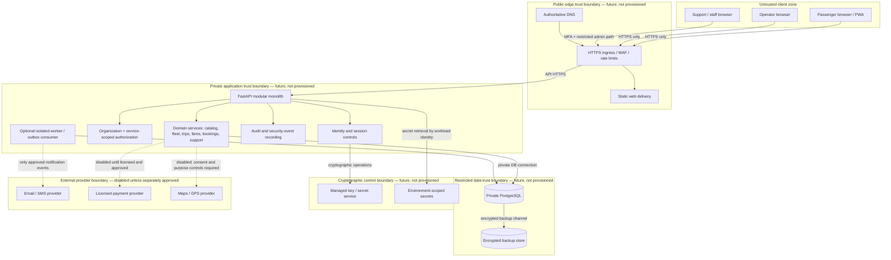
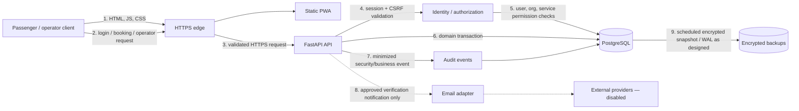
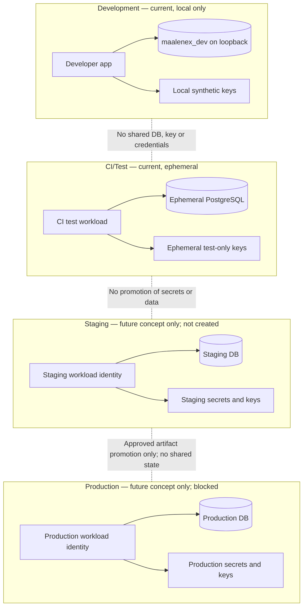

# MaaleNex A5.3.1 — Architecture, Trust Boundaries, Data Flows and Network-Security Specification

**Stage:** A5.3.1 architecture/design only  
**Status:** DESIGN BASELINE — provider-neutral; Owner review required  
**Repository:** `akefadaka-git/maalenex-moto`  
**Branch:** `a5/deployment-readiness-assessment`  
**Date:** 2026-11-09  
**Decision:** No provider selected. No infrastructure purchased, provisioned, configured or tested. No production runtime is authorized.

## 1. Purpose, scope and binding safety constraints

This document establishes a provider-neutral logical architecture, trust-boundary model, data-flow map, future environment-separation target, provider-selection criteria and network-security requirements for MaaleNex. It is an architecture specification, not an implementation plan approval or deployment authorization.

The existing application safeguards remain binding and must not be bypassed:

- `APP_ENV` remains restricted to `development` or `test`.
- `SYNTHETIC_DATA_ONLY=true` remains mandatory.
- PostgreSQL remains restricted to loopback and database `maalenex_dev`.
- No production runtime, real-person data processing, production credentials, live payments, live GPS, ticket issuance, boarding, public commercial service or deployment is authorized.
- A conceptual future staging/production environment in this document does not mean those environments exist or may be created.

A5.3.1 covers design only. Provider procurement, account creation, DNS, certificates, key generation, network provisioning, code changes and deployment require separate Owner approval.

## 2. Architecture decision record

### ADR-A5-01 — Modular monolith with isolated data and security services

**Decision proposed:** Retain the current modular FastAPI monolith, PostgreSQL/Alembic persistence and React/TypeScript/Vite client as the initial deployment architecture. Do not split into microservices for the passenger pilot.

**Rationale:**
- The current product is a bounded passenger-mobility foundation; independently deployed services would add operational and security complexity before demonstrated scale requires it.
- Domain boundaries already exist for identity, audit, organization, catalog, fleet, trips, fares, bookings and support.
- A single API deployment can enforce centralized authentication, service-scoped authorization, audit controls and transaction boundaries.
- PostgreSQL transactions and constraints remain appropriate for seat holds, reservations and fare snapshots.
- Separate external integrations (email, SMS, payment, maps/GPS) should be adapters with explicit enablement and isolated credentials, not embedded trust assumptions.

**Consequences:**
- Keep domain modules internally decoupled and prevent cross-domain direct table manipulation where service interfaces are available.
- Use a transactional outbox only when asynchronous delivery is introduced and separately approved.
- Extract a service only when measured scaling, isolation, regulatory or team-ownership needs justify the operational cost.
- Database remains private to the API runtime; browsers never connect directly to PostgreSQL.
- The existing local-only runtime guard remains unchanged until a separately approved migration stage.

**Alternatives considered:** premature microservices (rejected for initial scope); direct browser-to-database access (rejected); provider-specific managed architecture (deferred until provider and jurisdiction evidence exists).

## 3. Logical architecture

The target diagram is conceptual and describes security responsibilities, not deployed resources.

**Mandatory design rules**
1. Only the public edge may accept internet-originated connections.
2. Static web assets are untrusted client code; all authorization is enforced server-side.
3. API-to-database traffic uses a private network path and a dedicated least-privilege database identity.
4. The database, backup store, secrets service and administrative interfaces are not public endpoints.
5. Workloads retrieve only their own environment-scoped secrets using workload identity or an equivalent short-lived mechanism; no shared human-readable master secret.
6. External provider calls are outbound-only, purpose-limited and disabled by default unless their specific capability is separately authorized.
7. Audit events must not contain passwords, raw tokens, secret values, full payment credentials or unnecessary personal identifiers.

## 4. Trust-boundary model

| Boundary | Assets / principals | Threats | Required controls |
|---|---|---|---|
| TB-01 Client ↔ public edge | Passenger, operator, staff devices; browser sessions | XSS, CSRF, credential theft, replay, bots, request floods | HTTPS, HSTS after validated rollout, secure cookies, CSRF protection, rate limits, content security policy, input validation |
| TB-02 Public edge ↔ API | Reverse proxy and API workload | Header spoofing, origin bypass, request smuggling, oversized payloads | Private origin path, explicit proxy allowlist, canonical forwarded-header handling, request-size/time limits, origin access restricted to edge |
| TB-03 API ↔ PostgreSQL | API workload and DB identity | SQL injection, lateral movement, tenant leakage, credential theft | Private-only DB, TLS in transit, least-privilege DB role, parameterized queries, tenant predicates, row/transaction locking, audit |
| TB-04 Workload ↔ secrets/KMS | API/worker identity and cryptographic services | Key exfiltration, confused deputy, privilege escalation | Workload identity, per-environment/per-purpose keys, narrow crypto permissions, key versioning, access audit, rotation/recovery controls |
| TB-05 Workload ↔ external providers | Email/SMS, maps, payment providers | Data over-sharing, provider compromise, credential abuse, supply-chain risk | Outbound allowlist, scoped credentials, TLS verification, data minimization, provider contracts, disabled-by-default adapters |
| TB-06 Operations/admin ↔ control plane | Owner, authorized operators, CI maintainers | Account takeover, privilege abuse, accidental destructive change | MFA, separate named accounts, least privilege, protected branches/environments, approval logs, break-glass procedure |
| TB-07 Backup/recovery boundary | Database backups, restore operators, keys | Ransomware, deletion, backup tampering, key loss | Encryption, separate credentials/account boundary, immutable retention where feasible, restore tests, recovery-key custody |
| TB-08 CI/build ↔ repository/artifacts | GitHub Actions, source, build outputs | Untrusted PR secret access, dependency compromise, artifact tampering | No production secrets in CI, PR isolation, pinned/reviewed actions, dependency scanning, artifact provenance, protected release approval |

**Identity and tenant invariant:** An authenticated user is not automatically authorized for an organization, service or resource. Each protected operation must validate active user status, approved organization, active unrevoked membership, exact organization/resource ownership, service code and permission. Platform-wide `platform.*` permissions remain distinct from tenant service grants. Deny by default.

**No trust inheritance:** A successful login, a valid session, membership in another organization, possession of a client-supplied organization ID, or a request arriving through a proxy does not itself grant resource access.

## 5. Data-flow map and classification

### 5.1 Logical flows

### 5.2 Flow register

| Flow | Data | Trust crossing | Required safeguards | Current state |
|---|---|---|---|---|
| F-01 Browser delivery | Public application assets | Edge to client | HTTPS, integrity/deployment controls, CSP | No production edge evidenced |
| F-02 Authentication | Email/phone identifier, password, challenge/session tokens | Client to API; API to identity store | TLS, password hashing, rate limits, one-time challenge, token hashing, redaction | Implemented in synthetic/test scope |
| F-03 Organization authorization | User ID, organization ID, membership, service role | API to database | Server-derived tenant, exact service permission, active/revocation checks | Implemented for mapped operator route families |
| F-04 Catalog/trip discovery | Published routes, terminals, schedules, fare data | Client to API | Public-field allowlist, no private operator metadata | Existing read APIs; production exposure not authorized |
| F-05 Booking/reservation | Contact data, trip/seat selection, idempotency key, fare snapshot, reservation reference | Client to API and DB | Minimize PII, transaction locks, idempotency, expiry, access verification, tenant checks | Synthetic/test scope; no payment/ticket/boarding |
| F-06 Audit | Actor, action, target, outcome, bounded metadata | Domain service to audit store | Recursive redaction, no credentials/tokens, retention and access controls | Redaction tests implemented; production retention not specified |
| F-07 Email/SMS | Recipient address/number and verification message | API/worker to provider | TLS-only transport, minimal content, consent/contract, scoped secret | Email synthetic test path exists; SMS inactive; no new send authorized |
| F-08 Payment | Payment intent/status/reference | API to licensed provider | Legal classification, licensed provider, signed contract, idempotency, reconciliation, no raw card storage | DISABLED / NOT IMPLEMENTED |
| F-09 Location/maps | Device or route coordinates | Client/provider/API | Explicit consent, purpose limitation, retention, access controls | DISABLED / NOT AUTHORIZED |
| F-10 Backup/restore | Database snapshots/WAL and recovery metadata | DB to isolated backup boundary | Encryption, integrity, retention, restore drills, separate credentials | No production evidence |

### 5.3 Data classification and handling

| Class | Examples | Handling rule |
|---|---|---|
| Public | Published route names, public fares, public service descriptions | Explicitly approved for public response; exclude internal notes and unpublished records |
| Internal | Operational configuration, non-public route/vehicle records, staff workflow metadata | Authenticated least-privilege access; no public caching |
| Confidential | Account identifiers, contact details, booking records, audit metadata | Minimize, encrypt in transit/at rest, tenant-scope, log access, retention/deletion policy |
| Restricted secret | Passwords, session/challenge tokens, encryption/lookup keys, provider credentials | Never log, expose in frontend, commit or place in chat; hash/encrypt as appropriate; managed access and rotation |

No live or production data is to be used to validate these flows at this stage. Synthetic fixtures only.

## 6. Environment-separation model

### 6.1 Current state — only development/test exist

| Environment | Current authorization | Data | Database | Secrets | Network |
|---|---|---|---|---|---|
| Local development | ALLOWED under current guards | Synthetic only | Loopback PostgreSQL, `maalenex_dev` only | Local non-production values; never production credentials | Local machine only |
| CI/test | ALLOWED under current workflow controls | Ephemeral synthetic fixtures | Ephemeral PostgreSQL service | Ephemeral test keys; CI-only SMTP secrets only in specifically authorized test workflow | GitHub-hosted ephemeral runner/service |
| Staging | DOES NOT EXIST / NOT AUTHORIZED | None | None | None | None |
| Production | DOES NOT EXIST / BLOCKED | None | None | None | None |

### 6.2 Future logical target — design only

A future staging and production tier would require separate accounts/projects or equivalent hard isolation, separate networks, databases, identities, secrets, encryption keys, backup stores, logging scopes and provider credentials. Staging must not be a shared production tenant.

### 6.3 Separation invariants

- No database, key, secret, service account, cookie-signing material, backup bucket or provider credential is shared across environments.
- Environment identity must be explicit and validated at startup; unknown environment names fail closed.
- CI secrets are not made available to untrusted pull-request code. Production secrets must never be exposed to CI.
- Build artifacts are promoted by immutable digest; do not rebuild different source for each environment without traceability.
- Staging data must be synthetic or demonstrably anonymized under an approved policy; never clone production personal data by default.
- Production access, if later authorized, uses named human identities with MFA and short-lived workload credentials, not shared accounts.
- Backups and restore credentials are isolated from ordinary application credentials.
- Environment-specific CORS origins, cookie settings, callback URLs, SMTP and provider endpoints are explicit allowlists; no wildcard fallback.
- The current code's development/test-only validator is not to be weakened in order to make this model appear deployable.

## 7. Provider-selection criteria — no provider selected

A provider may be evaluated only after the Owner approves a shortlist and the intended data-processing scope. This section defines a scoring framework; it is not a recommendation or procurement request.

### 7.1 Mandatory pass/fail gates

Any candidate failing a mandatory gate is excluded regardless of score.

1. **Jurisdiction and data protection:** documented hosting region, subprocessors, cross-border transfer terms, data location controls and contract terms suitable for Ethiopian legal review.
2. **Account eligibility:** service and billing genuinely available to the organization from Ethiopia; clear account ownership, MFA, recovery and support. No dependence on inaccessible payment rails or mandatory deposits the organization cannot make.
3. **Security baseline:** private networking, firewall/security groups, TLS, managed secrets/KMS or credible equivalent, audit logs, backup encryption and least-privilege IAM.
4. **Operational recoverability:** exportable data, documented restore, independent backup retention, support escalation and a practical exit path.
5. **Cost transparency:** published pricing, currency/tax/FX implications, usage alerts, hard budget controls where available, no opaque mandatory minimums.
6. **Portability:** PostgreSQL compatibility, standard container/runtime support, exportable logs and metrics, infrastructure configuration portability and no unnecessary proprietary lock-in.
7. **Regional usability:** acceptable measured latency and reliable connectivity from the intended South Omo/Jinka user geography; test with evidence rather than marketing claims.
8. **Legal and contractual fit:** acceptable data-processing agreement, breach notification, deletion/return, audit rights and service continuity terms.

### 7.2 Weighted comparison rubric

| Criterion | Weight | Evidence required |
|---|---:|---|
| Security/IAM/KMS/network controls | 25% | Official security docs, independent certifications/reports, feature configuration evidence |
| Data residency/legal/subprocessor terms | 20% | Contract, region list, DPA, transfer terms |
| Cost and billing accessibility from Ethiopia | 15% | Current price calculator/quote, billing method availability, tax/FX, spending controls |
| Reliability, backup and support | 15% | SLA scope, support tier, restore options, incident history/communications |
| Regional performance/connectivity | 10% | Repeatable latency/availability tests from pilot geography |
| Portability and exit | 10% | Export test, PostgreSQL compatibility, IaC and egress pricing |
| Developer workflow and maintainability | 5% | Documentation, automation, access review, operational burden |

Score each criterion 0–5 with linked evidence and date. A high weighted score cannot override a failed mandatory gate. No vendor names are ranked in this baseline.

### 7.3 Procurement decision record required later

For each candidate record: legal entity/provider, region, data residency, account owner, billing method and eligibility, service components, monthly and variable cost scenarios, taxes/FX, support level, security evidence, DPA/subprocessors, backup/export/egress cost, SLA exclusions, exit plan, risks, score, and Owner decision. Do not enter payment details or create accounts as part of this A5.3.1 task.

## 8. Network-security specification

This is the minimum target-state control set for a separately approved implementation stage.

### 8.1 Network zones and permitted paths

| Source zone | Destination | Permit | Deny / constraints |
|---|---|---|---|
| Internet clients | Public edge | TCP 443 only | Deny direct access to API origin, DB, admin plane and backup services |
| Public edge | Web origin/API ingress | Only documented origin ports and authenticated/private origin path | Deny arbitrary east-west access |
| API workload | PostgreSQL | Required DB port only, private subnet, TLS where supported | Deny public DB exposure and all unrelated destinations |
| API/worker | Secrets/KMS | Provider-native private endpoint or TLS endpoint, workload identity | Deny broad account-wide key administration |
| API/worker | External email/SMS | Explicit provider hostname/port allowlist, TLS verification mandatory | Deny plaintext SMTP and unrestricted internet egress |
| API/worker | Payment/maps | Deny by default; enable only after separate legal, security and Owner gates | No live provider access in current stage |
| Admin identity | Control plane | MFA, named account, just-in-time least privilege, approved access path | Deny shared credentials and public DB administration |
| Backup service | Backup storage | One-way scoped write/read for backup/restore roles | Deny application workload deletion of protected backups where immutable controls exist |
| CI runner | Test services | Ephemeral job-scoped connectivity | No production network route or production credentials |

### 8.2 Edge and HTTP controls

- HTTPS-only public ingress; redirect HTTP to HTTPS only after a validated edge is approved.
- TLS 1.2 minimum (prefer TLS 1.3 where compatible); disable obsolete protocols and weak cipher suites.
- HSTS only after all relevant hostnames and HTTPS behavior are validated; use staged rollout before any preload decision.
- Automated certificate renewal with expiry monitoring, documented ownership and rollback.
- Explicit DNS registrar and zone access control with MFA, change logging and recovery.
- Trusted reverse-proxy addresses are explicitly enumerated. Trust only the immediate known proxy chain; reject or overwrite client-supplied forwarded headers at the edge.
- API origin must not be directly reachable from the public internet if a separate edge is used.
- Session cookies: Secure, HttpOnly, SameSite policy explicitly tested; CSRF double-submit token remains protected from cross-site misuse. Never rely solely on the request scheme when TLS terminates upstream.
- Credentialed CORS uses exact approved origins, methods and headers. No wildcard origins with credentials.
- Apply request-body size, header-size, connection, read and upstream timeouts; rate limits for authentication, challenge resend, booking and sensitive endpoints.
- Add CSP, frame-ancestors, nosniff, referrer policy and permissions policy after compatibility testing.
- Error responses must not disclose stack traces, secrets, database details or cross-tenant existence.

### 8.3 Workload and database controls

- Use separate service identities for API, worker, migrations, backups and observability.
- Runtime DB role must not own schema or have superuser/role-management privileges; migrations use a separate controlled identity.
- Database is private, encrypted at rest and in transit, with connection limits, statement timeouts, patching and audit configuration.
- Tenant authorization is enforced in application services and tested with authenticated cross-tenant HTTP requests; network segmentation is not a substitute for tenant authorization.
- No direct public administrative DB port. Administrative access uses a controlled private access path, MFA and recorded approval.
- Restrict outbound egress by service and destination; log denied/exception egress.
- Use immutable image/artifact references and vulnerability scanning before any future release.

### 8.4 Monitoring and incident signals to design for

Capture and alert on: repeated authentication failures, challenge abuse, privilege/role changes, cross-tenant denials, unusual admin access, secret/KMS access anomalies, DB connection spikes, egress-policy violations, certificate expiry, DNS changes, backup failures, restore failures, dependency vulnerabilities and service saturation. Logs must be structured, time-synchronized, access-controlled and recursively redacted. Retention periods and on-call ownership remain A5.5 decisions.

## 9. Security acceptance criteria for a future implementation stage

No tests or implementation are authorized by this document. When separately approved, acceptance evidence must include:

1. Network policy tests proving public access reaches only the edge and cannot reach DB/admin/backup endpoints.
2. Proxy-spoofing tests proving untrusted forwarded headers cannot force HTTPS scheme or cookie decisions.
3. Browser/API tests proving Secure, HttpOnly, SameSite and CSRF behavior behind the actual TLS terminator.
4. CORS tests for exact allowed origins and rejection of unapproved origins.
5. DB connectivity tests proving only the API workload and controlled migration/backup identities can connect.
6. Cross-tenant and cross-service negative HTTP tests for every protected route family.
7. Egress tests proving payment, GPS/maps and unapproved provider endpoints remain unreachable while disabled.
8. Secrets access tests proving each workload can access only its own environment/purpose secrets; no production credentials in CI.
9. Backup encryption, integrity, restore and key-recovery tests under separately approved A5.4 scope.
10. Evidence of security logging, redaction, alert delivery and incident response under separately approved A5.5 scope.

## 10. Open decisions and dependencies

| ID | Decision / dependency | Owner / gate | Status |
|---|---|---|---|
| ADR-01 | Select provider and hosting jurisdiction | Owner after legal/provider evidence | OPEN |
| ADR-02 | Approve data residency and cross-border processing model | Owner + qualified Ethiopian counsel | OPEN |
| ADR-03 | Set budget ceiling and acceptable billing path | Owner | OPEN |
| ADR-04 | Choose DNS/domain and certificate ownership model | Owner | OPEN |
| ADR-05 | Approve RTO/RPO, availability and support targets | Owner / A5.4–A5.5 | OPEN |
| ADR-06 | Approve secret manager, key hierarchy and key custodians | Owner / A5.3.2 | OPEN |
| ADR-07 | Approve TLS termination and trusted-proxy design | Owner / A5.3.3 | OPEN |
| ADR-08 | Define privacy retention, data-subject and processor requirements | Owner + counsel / A5.6 | OPEN |
| ADR-09 | Determine transport and payment regulatory classification | Owner + counsel / A5.7 | OPEN |

## 11. A5.3.1 disposition

| Deliverable | Result |
|---|---|
| Logical architecture and ADR | PREPARED — provider-neutral |
| Trust-boundary model | PREPARED |
| Data-flow map and classification | PREPARED |
| Current/future environment separation model | PREPARED; future tiers are conceptual only |
| Provider-selection criteria | PREPARED; no vendor selected |
| Network-security specification | PREPARED; no network configured |
| External provider / billing / legal verification | NOT RUN |
| Infrastructure purchase or provisioning | NOT PERFORMED |
| Production runtime / secrets / DNS / TLS changes | NOT PERFORMED |

**A5.3.1 result: DOCUMENTATION PREPARED; Owner review and decision pending.** This does not close A5.3 or establish production readiness. The overall A5 decision remains **NOT READY / NO-GO**.

### Next separately gated design work

- A5.3.2: versioned identity-encryption and lookup-key lifecycle design — PREPARED in [MAALENEX-A5-3-2-VERSIONED-KEY-LIFECYCLE-DESIGN.md](MAALENEX-A5-3-2-VERSIONED-KEY-LIFECYCLE-DESIGN.md); Owner review pending. No key generation.
- A5.3.3: TLS termination, trusted-proxy, cookie, CORS and ingress contract. No DNS/certificate change.
- A5.3.4: synthetic-only fail-closed configuration tests only after separate implementation authorization.

## 12. Change and approval record

- Prepared on branch `a5/deployment-readiness-assessment`.
- No default-branch changes, PR merges or deployments.
- No provider account, subscription, resource, domain, certificate, secret or key created.
- No real personal data, payment, GPS, email or SMS activity performed.
- Owner approval is required before implementation, procurement, provisioning, production configuration or deployment.
