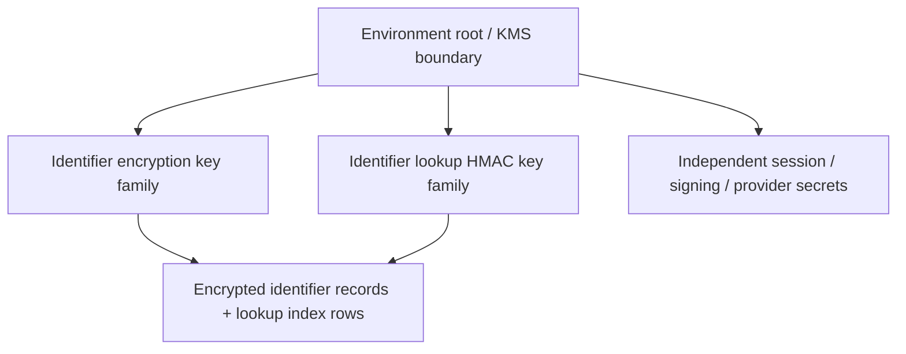
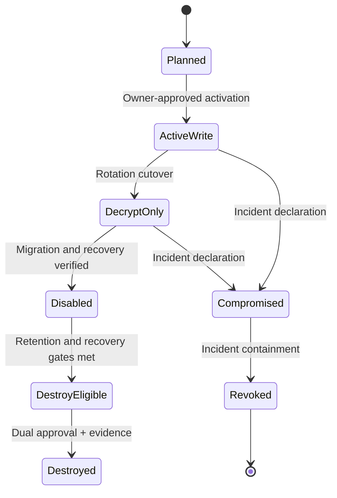

# MaaleNex A5.3.2 — Versioned Encryption and Lookup-Key Lifecycle Design

**Stage:** A5.3.2 design only — no implementation or key ceremony
**Repository:** `akefadaka-git/maalenex-moto`
**Branch:** `a5/deployment-readiness-assessment`
**Decision:** Define versioning, migration, rollback, recovery, revocation and verification requirements. No key material is generated, retrieved, rotated, revoked, copied or stored by this work.

## 1. Scope and non-negotiable constraints

This specification covers the two distinct cryptographic functions currently used by identity storage:
- **Identifier encryption key:** AES-256-GCM protects recoverable identity values (such as email/phone) at rest.
- **Lookup key:** HMAC-SHA-256 produces deterministic lookup digests so the application can find an identity without storing a plaintext searchable identifier.

These keys are not interchangeable and must have independent key IDs, access policies, rotation schedules, recovery procedures and audit events. Password hashing (PBKDF2-HMAC-SHA-256 with per-password salts), SHA-256 token digests and provider credentials are separate mechanisms and are outside the data re-encryption procedure.

Preserve the current hard guards: `APP_ENV` remains development/test only; `SYNTHETIC_DATA_ONLY=true`; PostgreSQL remains loopback-only and database `maalenex_dev`. No production runtime, real personal data, infrastructure, key manager, key generation, key rotation, provider calls, merge or deployment is authorized.

## 2. Current-state baseline and gaps

Source inspection recorded in A5.3 found:
- Identifier values are encrypted using AES-256-GCM with a 12-byte nonce; the identifier type is supplied as associated authenticated data.
- The current encrypted payload does not carry explicit key-version metadata.
- The application derives a 32-byte key from configured UTF-8 material using SHA-256 after enforcing a minimum length. This is not evidence of high-entropy key generation or a managed key ceremony.
- Lookup digests use HMAC-SHA-256 and a separately configured lookup key.
- Replacing the encryption key in-place would make existing ciphertext undecryptable. Replacing the lookup key in-place would make existing stored digests unmatchable unless records are re-indexed.
- No production secret manager, version registry, dual-key migration, recovery custody, revocation process or rotation exercise is evidenced.

**Design consequence:** Do not change either existing environment variable in isolation. Introduce explicit key IDs and a controlled migration protocol before any future production dataset is admitted.

## 3. Key hierarchy and separation

### 3.1 Logical hierarchy

Use an approved KMS/HSM or equivalent managed key service as the future root of trust. The application should receive narrowly scoped data-key operations or short-lived wrapped data keys; it should not receive broad KMS administration rights.

### 3.2 Separation requirements

- Separate keys for encryption and lookup; never reuse key bytes across purposes.
- Separate development, CI, staging and production key namespaces. No cross-environment key reuse or promotion.
- Separate key IDs and authorization scopes by environment, purpose and version.
- Key metadata may be stored with ciphertext; secret key material must not be stored in application tables, source control, logs, browser code or this document.
- Runtime identity may perform only the required encrypt/decrypt or HMAC operation. Key creation, policy changes, disabling, deletion and administration belong to a separately authorized custodian role.
- Require multi-person approval for production key disablement/destruction and recovery actions, if a future governance policy adopts such controls.
- Never treat a hash of a low-entropy secret as a secure key-generation procedure. Future key material must originate from a cryptographically secure KMS/HSM or approved CSPRNG ceremony and be stored/handled by the approved secret-management boundary.

## 4. Versioned ciphertext envelope

### 4.1 Target record format

Replace implicit single-key ciphertext with a versioned envelope. Proposed logical fields:

| Field | Purpose |
|---|---|
| `format_version` | Envelope serialization version, independent of key version |
| `algorithm` | Allowlisted algorithm identifier, initially AES-256-GCM |
| `key_id` | Immutable identifier of the exact encryption-key version |
| `nonce` | Unique 96-bit GCM nonce for this encryption operation |
| `ciphertext` | Authenticated encrypted identifier bytes |
| `tag` | GCM authentication tag (or encoded with ciphertext according to one canonical format) |
| `aad_version` | Version of associated-data construction |
| `identifier_type` | Canonical type bound into AAD, e.g. email or phone |

Canonical AAD must bind at least the tenant/organization scope where applicable, stable record identifier, identifier type, and envelope format version. AAD values must be derived from trusted persisted record context, not accepted as authoritative from the caller. Define a deterministic canonical byte encoding before implementation; do not concatenate ambiguous strings.

Nonce uniqueness under a given AES-GCM key is mandatory. Use a CSPRNG or a vetted KMS encryption API; define collision monitoring and per-key usage limits. Never reuse a nonce with the same key. Authentication failure is a hard failure: do not return partial plaintext or silently fall back to another key.

### 4.2 Read and write behavior

- **Write:** encrypt only with the active write key ID; persist the key ID and envelope metadata atomically with the record.
- **Read:** parse and validate the envelope; resolve only the exact referenced key ID; authenticate AAD and tag; fail closed if key ID is unknown, disabled for decrypt, or authentication fails.
- **Legacy read:** during a bounded migration only, legacy records without key ID may be read through one explicitly configured legacy key path. Count and alert every legacy read. Do not guess among a list of keys.
- **No plaintext fallback:** missing key, malformed envelope, tag failure or unsupported version must never cause plaintext interpretation.
- **No key ID supplied by a user:** key selection is a server-side storage concern, not an API parameter.

## 5. Encryption-key lifecycle

### 5.1 States

State semantics:
- **Planned:** metadata and policy approved; no key generated by this design task.
- **ActiveWrite:** may encrypt and decrypt; only one active writer per environment/purpose unless a formally designed multi-writer scheme is approved.
- **DecryptOnly:** may decrypt legacy records but cannot encrypt new values.
- **Disabled:** no normal runtime use; retained in controlled recovery custody only if policy permits.
- **Compromised/Revoked:** immediate deny for ordinary use; incident-specific recovery may use a quarantined process and must be separately approved.
- **Destroyed:** irreversible removal only after legal retention, backup expiry, recovery and Owner approval gates are satisfied.

### 5.2 Planned rotation sequence

1. **Preflight:** inventory every ciphertext consumer, table, export, backup, job, cache and restore path; count records by legacy/key ID; establish a synthetic baseline and verified restore point.
2. **Prepare:** register a new key version in the future key manager; verify workload identity permissions and audit events. This step is not authorized now.
3. **Dual-read:** deploy code that can decrypt the legacy format and the new envelope by explicit key ID. Continue writing with the old active key until compatibility is verified.
4. **Write cutover:** switch the active write key ID to the new version through a controlled configuration change. New/updated records use only the new key.
5. **Backfill:** process records in bounded, resumable batches. Decrypt using the recorded old key, validate plaintext in memory, re-encrypt with a fresh nonce under the new key, and atomically compare-and-swap the row using its previous version/hash. Never emit plaintext to logs, queues or reports.
6. **Verify:** compare total eligible rows, successfully migrated rows, skipped/failed rows, key-ID distribution and authenticated decrypt checks. Require zero unexplained failures and a complete reconciliation before proceeding.
7. **Observe:** retain the old key in decrypt-only state for a defined rollback/recovery window; monitor legacy reads and decryption failures.
8. **Retire:** disable ordinary old-key use only after all online data, replicas, exports and retained backups that require it have expired or been re-encrypted under an approved backup-key plan. Destruction is a separate Owner approval.

Backfill must be idempotent, rate-limited, checkpointed and safe to resume. It must not change identifier ownership, tenant association, verification status or business semantics. A migration must never silently drop an unreadable row.

## 6. Lookup-key lifecycle and index migration

Lookup rotation is not ciphertext rotation. Existing HMAC digests cannot be transformed into new-key digests without access to the original identifier value (or a separately designed protected source).

### 6.1 Target index model

Represent each lookup digest as a versioned index row, logically:

| Field | Purpose |
|---|---|
| `identifier_record_id` | Reference to encrypted identifier record |
| `lookup_key_id` | Exact HMAC key version |
| `digest` | HMAC-SHA-256 output |
| `normalization_version` | Versioned canonicalization rules |
| `created_at` | Audit and migration evidence |

Uniqueness must be scoped to identifier type and the appropriate tenant/global identity namespace. The exact uniqueness constraint must preserve current account identity semantics and be reviewed against existing data before implementation.

### 6.2 Dual-index migration

1. Inventory current normalization rules, digest columns/indexes, uniqueness scope, duplicate behavior and every lookup path.
2. Add a versioned index representation while preserving existing rows and constraints. Migration must be additive and reversible before any new-key writes begin.
3. Register the new lookup key version under separate HMAC-only permission. Keep old key available for reads during the transition.
4. For every identifier record, decrypt its stored value using the encryption-key envelope, apply the exact canonical normalization version, and compute the new HMAC digest in memory.
5. Insert the new versioned digest idempotently. Do not expose normalized identifiers or digests in logs.
6. During dual-read, compute lookup candidates under the explicitly enabled old and new lookup versions and query the matching versioned index rows. Do not perform unbounded all-key scans.
7. During dual-write, every identifier create/change produces the active-version digest and, while needed for compatibility, the old-version digest in one database transaction.
8. Reconcile counts, duplicates, uniqueness conflicts, orphaned index rows and lookup success against synthetic known-answer fixtures. Resolve collisions/duplicates through a documented identity-resolution process; never auto-merge accounts.
9. After all records are indexed and lookup traffic proves the old version is unused, cut over reads to the new key only.
10. Retain the old key and index through the rollback and backup-retention window. Remove old index rows only after the rollback gate and backup dependencies are satisfied; destroy the old key only through a separate approval.

**Critical constraint:** If a stored identifier cannot be decrypted, its new lookup digest cannot be safely regenerated. Quarantine the record for controlled recovery; do not guess, substitute a user-supplied value or silently lock out the account.

## 7. Rollback design

Rollback is asymmetric:
- Before write cutover: revert application code/configuration; no data re-encryption should have begun.
- After encryption write cutover but before full backfill: retain both key versions and dual-read support; roll back writes to the old key only if it is not compromised and remains authorized. New-key ciphertext remains readable through the retained new key.
- After encryption backfill: do not simply switch the active key setting. Either continue dual-read with the new key, or execute a separately tested reverse re-encryption migration using fresh nonces and compare-and-swap. Never re-encrypt from a database snapshot that predates valid user updates.
- After lookup dual-write: retain both index versions and dual-read. Revert active lookup writes only if old key is safe and all current records remain resolvable under it.
- After lookup cutover: restore old lookup reads only while the old index and key are retained and reconciliation proves coverage.
- If a key is compromised, rollback to it is prohibited. Use incident containment and forward recovery to a clean key version.

Every rollback plan must specify schema compatibility, application version compatibility, data checkpoint, backup restore point, expected downtime, owner, abort thresholds and evidence. Rollback must not restore an exposed/compromised key.

## 8. Recovery, backup and disaster recovery

- Recovery material is held outside the application database and outside ordinary application credentials, in a separately approved managed custody boundary.
- Define custodians, quorum/dual control, emergency access, identity verification, access logging, periodic access review and tested break-glass expiry.
- Backups must preserve ciphertext envelope metadata, lookup key IDs/index rows and schema compatibility. Backup encryption keys are a distinct purpose and key family.
- A restore is not complete until the restored application can decrypt a representative synthetic record set, resolve versioned lookup fixtures, verify referential integrity and demonstrate no plaintext leakage.
- Recovery tests must include missing key version, disabled key, corrupted ciphertext/tag, unavailable KMS, expired credential, partial backfill and restored backup older than the active key cutover.
- Define RTO/RPO and backup retention under A5.4 before production decisions. Do not invent targets in this design.
- Never place key material in database backups, GitHub artifacts, workflow logs, support tickets or chat.

## 9. Revocation and compromise response

### 9.1 Planned revocation triggers

Suspected key disclosure, unauthorized KMS access, unexpected decrypt/HMAC volume, compromised workload identity, accidental repository/log exposure, unexplained integrity failures or provider security notification must trigger incident triage.

### 9.2 Response sequence

1. Declare incident and identify exact key IDs, purposes, environments and affected records.
2. Preserve relevant audit evidence; restrict access and suspend the compromised workload identity or key operation.
3. Disable compromised key for normal encrypt/decrypt or HMAC operations according to incident containment policy. Do not delete forensic evidence.
4. Assess whether ciphertext confidentiality, lookup privacy, integrity or account enumeration is affected; identify backup/export exposure.
5. Create and activate a clean replacement only under a separately approved key ceremony (not part of this task).
6. Re-encrypt affected ciphertext or rebuild lookup indexes using controlled recovery. For encryption-key compromise, assume exposed ciphertext may be readable; re-encryption does not reverse prior disclosure.
7. Revoke related sessions/tokens or rotate other credentials only where evidence shows exposure; avoid indiscriminate destructive changes.
8. Verify migration and application behavior, document affected scope and notify legal/affected parties where required by counsel and applicable law.
9. Retire old key material only after incident, retention and evidence-preservation requirements are met and the Owner approves.

Revocation must be key-ID specific. A global environment-variable swap is not a sufficient revocation mechanism.

## 10. Verification and test plan (future synthetic-only tests)

No tests were run as part of this design task. The following test suite is required before a separately approved implementation can be considered complete.

| ID | Test | Expected result |
|---|---|---|
| KLV-01 | New envelope round-trip for each supported identifier type | Exact plaintext recovery; no plaintext persisted |
| KLV-02 | AAD altered (tenant, record ID, identifier type, format version) | Authentication failure; no plaintext returned |
| KLV-03 | Ciphertext/tag/nonce corruption | Fail closed; security event without secret material |
| KLV-04 | Unknown, missing, disabled or revoked key ID | Explicit safe failure; no fallback guessing |
| KLV-05 | Legacy record without key ID | Only explicit legacy reader works during migration window; counter increments |
| KLV-06 | Mixed old/new encryption-key records | Reads resolve by exact key ID; writes use active version only |
| KLV-07 | Encryption backfill interruption/restart | Idempotent resume; no lost or duplicate identity records |
| KLV-08 | Concurrent identifier update during backfill | Compare-and-swap prevents stale overwrite |
| KLV-09 | Encryption migration reconciliation | Counts balance; zero unexplained failures; decrypt checks pass |
| KLV-10 | Rollback after partial and complete backfill | Both versions remain readable; no compromised-key rollback |
| KLV-11 | Lookup dual-index known-answer tests | Old/new digest fixtures resolve to the same identity |
| KLV-12 | Lookup dual-write transaction failure | No partial index state; transaction rollback or safe retry |
| KLV-13 | Lookup backfill interruption/restart | Idempotent and resumable; uniqueness preserved |
| KLV-14 | Duplicate/normalization conflict | Quarantined for review; no automatic account merge |
| KLV-15 | Lookup cutover and rollback | Each active mode resolves all reconciled synthetic identities |
| KLV-16 | Missing old lookup key/index | Explicit failure/alert; no false account-not-found response that causes unsafe registration |
| KLV-17 | Recovery from backup with historical key IDs | Restored synthetic dataset is decryptable and searchable |
| KLV-18 | Revoked/compromised key | Ordinary workload denied; incident recovery path audited |
| KLV-19 | Logs, exceptions, metrics and traces | No plaintext identifier, key bytes, nonce+ciphertext bundle, token or digest leakage |
| KLV-20 | Cross-environment isolation | Dev/test identity cannot read staging/production key aliases or ciphertext |
| KLV-21 | Authorization and audit | Only approved workload identity can use crypto operations; admin actions recorded |
| KLV-22 | Algorithm/version allowlist | Unsupported algorithm/envelope version rejected |

Test fixtures must be synthetic and deterministic. Do not place real key values in fixtures, snapshots, reports or test output. CI must use ephemeral test-only values, mask them before any logging and never receive production secrets.

## 11. Migration gates and evidence

| Gate | Required evidence | Exit condition |
|---|---|---|
| G0 Inventory | Table/column/consumer/backup/export inventory; row counts; current normalization and key configuration references | No unknown ciphertext or lookup consumer |
| G1 Schema compatibility | Additive schema design, constraints, migration and downgrade review | Existing rows and application behavior preserved |
| G2 Crypto compatibility | Versioned envelope and exact key resolver tests | Legacy and new records read correctly; fail-closed behavior proven |
| G3 Encryption backfill | Checkpointed synthetic migration, reconciliation and restart test | Every eligible row accounted for |
| G4 Lookup dual-index | Normalization, dual-write/read and uniqueness evidence | All synthetic identities resolve; no unexplained duplicates/orphans |
| G5 Cutover | Traffic/read counters, error budgets, rollback rehearsal | Old version no longer needed for ordinary reads |
| G6 Recovery/revocation | Restore, break-glass, compromise and key-disable exercises | Recovery and containment proven with audit evidence |
| G7 Retirement | Backup expiry, legal retention, restore dependency and Owner decision | Explicit approval before old key destruction |

Any failed reconciliation, unknown key ID, authentication failure, unexplained duplicate, missing backup key, or untested rollback blocks progression. No gate is auto-approved by passing unit tests alone.

## 12. Decisions still required

| Decision | Required input | Status |
|---|---|---|
| Key manager/KMS and jurisdiction | Provider evidence, account eligibility, residency and contract review | OPEN |
| Key generation ceremony | Approved entropy source, custodians, access policy and audit | OPEN |
| Encryption envelope canonical encoding/AAD | Backend schema and consumer inventory review | OPEN |
| Lookup normalization versioning | Existing identifier normalization and uniqueness inventory | OPEN |
| Rotation/retention windows | RTO/RPO, backup retention and legal retention decisions | OPEN |
| Recovery quorum and break-glass | Named roles and governance policy | OPEN |
| Incident notification obligations | Qualified Ethiopian counsel and provider contract | OPEN |

## 13. A5.3.2 disposition

| Deliverable | Status |
|---|---|
| Encryption-key versioning design | PREPARED |
| Versioned AES-GCM envelope and AAD requirements | PREPARED |
| Encryption migration and rollback protocol | PREPARED |
| Lookup-key versioning and dual-index protocol | PREPARED |
| Recovery, revocation and compromise response | PREPARED |
| Synthetic verification test plan | PREPARED; NOT RUN |
| Key inventory against every production data consumer | NOT RUN |
| Provider/KMS selection and operational key ceremony | NOT PERFORMED |
| Key generation, rotation, revocation or deletion | NOT PERFORMED |

**A5.3.2 result: DESIGN PREPARED; Owner review pending.** This does not close A5.3 and does not establish production readiness. Overall A5 remains **NOT READY / NO-GO**.

## 14. Change and approval record

- Documentation-only change on `a5/deployment-readiness-assessment`.
- No application code, database schema, migration, runtime configuration or workflow changed.
- No key material generated, retrieved, rotated, revoked, copied or destroyed.
- No secret manager, infrastructure, provider account, DNS, certificate or network resource created or modified.
- No production data, email, SMS, payment, GPS, merge, deployment or commercial activation.
- Implementation and every production action remain separately gated by explicit Owner approval.