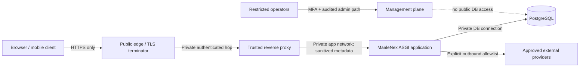

# MaaleNex A5.3.3 — TLS Termination, Trusted-Proxy, Cookie, CORS and Ingress Security Contract

**Stage:** A5.3.3 design specification only  
**Status:** CONTRACT PREPARED — Owner review pending; no runtime implementation  
**Repository:** `akefadaka-git/maalenex-moto`  
**Branch:** `a5/deployment-readiness-assessment`  
**Date:** 2026-11-09  
**Decision:** **NO-GO for public ingress or production traffic until the controls and evidence in this contract are implemented and independently verified under a separately approved stage.**

## 1. Purpose, scope and non-authorizations

This contract defines the required security behavior at the public edge and between the TLS terminator, trusted reverse proxy, ASGI application, browser session and cross-origin frontend.

In scope:

- TLS termination and end-to-end transport boundaries;
- reverse-proxy identity, forwarded-header sanitization and trusted-proxy allowlisting;
- canonical host and scheme handling;
- session-cookie, CSRF-cookie and browser security requirements;
- credentialed CORS allowlisting;
- ingress/network restrictions, request limits, security headers and operational evidence;
- synthetic-only verification requirements for a future implementation stage.

This document does **not** select a hosting, DNS, CDN, WAF or certificate provider. It does not change DNS, certificates, runtime configuration, application code, secrets, infrastructure, firewall rules, workflows, or network resources. It does not perform a live TLS scan or send requests to a production hostname. It does not authorize public ingress, merge, deployment, production activation, real personal data, payments, GPS or commercial operations.

The existing hard safety boundary remains binding and must not be bypassed:

- `APP_ENV` remains restricted to `development` or `test`;
- `SYNTHETIC_DATA_ONLY=true` remains mandatory;
- PostgreSQL remains loopback-only and database `maalenex_dev`;
- no production runtime mode is introduced by this contract.

## 2. Normative language and security invariants

The terms **MUST**, **MUST NOT**, **SHOULD**, **SHOULD NOT** and **MAY** are normative requirements.

1. The browser-to-edge connection MUST use authenticated HTTPS. HTTP MUST NOT carry application credentials or session state; it may only redirect to the canonical HTTPS origin at the edge.
2. The edge MUST be the only public entry point. The application and database MUST NOT be directly internet-reachable.
3. The application MUST trust proxy metadata only from explicitly enumerated, controlled proxy peers. It MUST NOT infer trust from the presence of a forwarded header.
4. A trusted proxy MUST remove client-supplied forwarding headers and write its own canonical values. Duplicate, malformed, conflicting or untrusted forwarding metadata MUST be rejected or ignored safely.
5. Session cookies MUST be Secure, HttpOnly and SameSite=Lax (or stricter where compatible); CSRF protection MUST remain active for state-changing browser requests.
6. Credentialed CORS MUST use an exact, reviewed origin allowlist. Wildcard origins, suffix matching, reflected arbitrary origins and wildcard credentials MUST NOT be used.
7. Host, scheme, origin, cookie and proxy behavior MUST fail closed. A malformed or untrusted request MUST NOT downgrade transport security or broaden access.
8. Secrets, tokens, cookies, authorization headers, personal identifiers and sensitive request bodies MUST NOT be logged at the edge or application.
9. No control in this document is considered implemented merely because it is specified here.

## 3. Target trust and termination model

### 3.1 Logical request path

The diagram is a target logical model, not evidence of an existing deployment. The exact topology (single proxy or multiple controlled hops) must be recorded before implementation. The application MUST see the actual network peer that connects to it; proxy trust MUST be based on that peer address and the approved hop topology.

### 3.2 Termination choices

The eventual deployment MUST choose and document exactly one supported pattern per environment:

- **Pattern A — Edge terminates TLS and forwards over a private encrypted hop:** TLS is terminated at the edge; edge-to-application traffic uses a private network and TLS/mTLS where supported by the selected topology. This is the preferred baseline for any hop crossing a shared, provider, or otherwise untrusted network.
- **Pattern B — Edge passes TLS to an internal terminator:** the internal terminator owns the certificate and TLS policy; the application still receives requests only through the explicitly trusted proxy chain.

Plaintext proxy-to-application traffic MAY be considered only when the hop is demonstrably confined to a dedicated, isolated host/network with restrictive access controls and the residual risk is documented and approved. It MUST NOT be assumed safe merely because the provider calls the network private.

TLS MUST terminate at a controlled component whose configuration, patching, access, certificate lifecycle and logs have named owners. The TLS terminator MUST validate upstream identity where encrypted upstream transport is used.

### 3.3 Canonical authority

Before implementation, record the canonical public origins and hostnames for each environment. The application MUST enforce an explicit host allowlist at the edge and, where supported, at the application layer. Unknown Host values, unexpected ports, malformed authority values and host-header injection MUST be rejected. Redirect targets MUST be constructed from configured canonical origins, never from an untrusted Host or forwarded-host header.

No production hostname is selected or asserted by this document.

## 4. TLS and certificate policy

| Control | Required contract | Evidence required before production |
|---|---|---|
| Browser transport | HTTPS for every authenticated and application endpoint; HTTP redirects only to the configured canonical HTTPS origin | External scan and redirect tests |
| Protocols | TLS 1.2 minimum; TLS 1.3 preferred; disable SSL and TLS 1.0/1.1 | Scanner protocol report |
| Cipher suites | Modern AEAD suites; disable NULL, anonymous, export, RC4, 3DES and weak CBC suites; use provider-supported secure defaults | Scanner cipher report and reviewed edge config |
| Server identity | Valid certificate chain, correct SAN/hostname, trusted CA, current validity | Automated hostname/chain verification |
| Renewal | Automated renewal with monitored success and expiry alerts; controlled renewal failure runbook | Successful renewal rehearsal and alert evidence |
| HSTS | Enable only after all covered subdomains are HTTPS-ready; begin with a reviewed max-age and increase deliberately | Header tests and subdomain inventory |
| HSTS preload | Do not request preload by default; separate review required because preload is difficult to reverse | Explicit Owner decision |
| OCSP/stapling | Enable where supported and operationally reliable | Edge configuration and external check |
| TLS termination admin | Least-privilege access, MFA, audit trail, restricted management network | Access review and audit evidence |

HSTS MUST NOT be enabled with `includeSubDomains` until every affected subdomain has verified HTTPS support and a recovery plan. Preload is not part of this contract. Certificate private keys MUST never be committed to Git, placed in frontend assets, exposed in logs, or shared with application workloads that do not need them.

## 5. Trusted-proxy and forwarded-header contract

### 5.1 Trust establishment

- Maintain an explicit allowlist of proxy peer IPs/CIDRs for each environment. The list MUST be derived from the actual provider/network topology and kept current through a reviewed change process.
- Trust MUST be attached to the immediate network peer and exact expected proxy chain. Never use unrestricted trust values such as `*`, `0.0.0.0/0` or a blanket “trust all forwarded headers” setting.
- The app listener MUST be private and firewall-restricted so only approved proxy peers can reach it.
- If the hosting platform uses dynamic proxy addresses, use a provider-supported authenticated/private network identity mechanism or a controlled, automatically reconciled allowlist. Do not disable validation to accommodate changing addresses.
- If the framework/server supports a trusted-host or forwarded-allowlist option, configure it with the approved peer set; confirm its semantics against the actual ASGI server and middleware version before deployment.

### 5.2 Header processing

At the first trusted edge, remove inbound client-supplied values for at least:

- `Forwarded`
- `X-Forwarded-For`
- `X-Forwarded-Host`
- `X-Forwarded-Proto`
- `X-Forwarded-Port`
- `X-Real-IP`
- provider-specific client-IP headers unless explicitly selected and validated.

The trusted edge MUST write canonical forwarding metadata. Each subsequent trusted hop MUST append or replace values according to one documented chain convention; ambiguous multi-value parsing MUST NOT be left to implicit framework defaults.

The application MUST:

1. determine the direct peer from the socket/network connection;
2. accept forwarded scheme/host/client-IP metadata only when that peer is in the trusted allowlist;
3. validate the forwarded scheme against the allowed value (`https` for public application traffic);
4. validate the forwarded host against the canonical host allowlist;
5. reject malformed, conflicting, duplicated or unexpectedly long forwarding values;
6. ignore or reject forwarded metadata from all untrusted peers;
7. avoid using client-IP headers as an authorization factor; use them only for carefully designed abuse controls and security telemetry.

If proxy metadata is absent or invalid, the app MUST NOT assume HTTPS based on an arbitrary header. The request MUST fail safely or be treated as non-secure and denied for authenticated browser operations. The application MUST NOT generate absolute links, redirects or security decisions from untrusted forwarded host/scheme data.

### 5.3 Client IP and multi-proxy chains

The deployment design MUST identify the exact number and order of proxy hops. Rate limiting and audit attribution MUST use the client address extracted from that validated chain, not the leftmost arbitrary value supplied by the client. If the chain cannot be validated, use the direct peer for transport-level controls and record the attribution as unknown; do not grant access or bypass throttling.

## 6. Cookie, session and CSRF contract

### 6.1 Session cookies

All authenticated session cookies MUST have:

- `Secure`: always true on HTTPS application traffic, including when TLS terminates before the ASGI process;
- `HttpOnly`: true;
- `SameSite=Lax`: default; stricter `Strict` MAY be used only after compatibility review;
- `Path=/` or the narrowest correct application path;
- no `Domain` attribute unless a documented cross-subdomain requirement exists; host-only cookies are preferred;
- explicit bounded lifetime and server-side revocation/expiry enforcement.

Use a `__Host-` cookie prefix where compatible: it requires Secure, Path=/ and no Domain attribute. If the current cookie architecture cannot meet these conditions, document the exact compatibility reason and use a host-only Secure cookie without broadening domain scope. Never set session cookies for a parent domain merely for convenience.

The session identifier MUST remain opaque, high-entropy and server-validated. Cookie rotation on authentication/privilege change, logout invalidation, idle/absolute expiry and revocation MUST be covered by the identity/session contract. Do not store access tokens or secrets in browser local storage.

### 6.2 CSRF cookie and request validation

The existing double-submit design may retain a JavaScript-readable CSRF cookie, but it MUST be:

- Secure on HTTPS;
- SameSite=Lax (or stricter after compatibility review);
- host-only and narrowly scoped;
- non-sensitive (it must not be an authentication credential);
- paired with a request header/token comparison and server-side origin checks for state-changing browser requests.

For unsafe methods (POST, PUT, PATCH, DELETE), require a valid CSRF token and validate the request Origin against the exact trusted frontend origins. Where Origin is absent for a legitimate non-browser client, require an explicit non-cookie authentication mode and document its separate CSRF threat model; do not silently waive CSRF for cookie-authenticated requests.

CORS is not a substitute for CSRF protection. SameSite is defense in depth, not the only CSRF control.

### 6.3 Secure scheme behind a proxy

The app MUST NOT rely solely on the ASGI request URL scheme if TLS terminates upstream. Secure-cookie behavior MUST be determined from a trusted deployment security context: an explicit secure-cookie policy plus validated proxy trust. An untrusted `X-Forwarded-Proto: https` MUST NOT make the application set Secure cookies or treat a request as HTTPS.

The current `secure_cookies=false` default is development-oriented. A future deployment MUST explicitly configure Secure cookies as mandatory through a reviewed configuration design; this contract does not change that setting or authorize a production mode.

## 7. CORS contract

### 7.1 Exact origin allowlist

For each environment, maintain a reviewed list of exact origins, including scheme, hostname and non-default port where applicable. An origin is the tuple (scheme, host, port), not a URL path.

- No `*` origin when credentials are enabled.
- No wildcard subdomain, suffix, substring or regex matching that can accept attacker-controlled lookalike domains.
- No blind reflection of the request `Origin`.
- Reject `null` origin unless a separately reviewed use case exists.
- Development origins MUST NOT be present in staging/production allowlists.
- Production origins MUST NOT be introduced into development/test by default.
- The API MUST return `Access-Control-Allow-Credentials: true` only for an exact allowed origin.
- Add `Vary: Origin` when responses vary by allowed origin.

### 7.2 Methods, headers and preflight

Allow only methods required by the documented API surface. Allow only explicit request headers required by the frontend, such as content type, CSRF header and authorization header if a separately approved token client requires it. Do not allow arbitrary headers or methods by default.

Preflight responses MUST be bounded, deterministic and must not perform business mutations. Set a finite max-age compatible with revocation/change requirements. CORS errors MUST NOT disclose tenant existence, account status or protected resource metadata.

### 7.3 Credential model

Credentialed browser access MUST be limited to the exact first-party frontend origin(s). Third-party origins MUST use a separately designed, non-cookie integration flow with scoped credentials and explicit authorization; they MUST NOT be added to the browser credential allowlist as a shortcut.

## 8. Ingress, network and HTTP security controls

| Layer | Required control |
|---|---|
| Public edge | Expose only required HTTPS listener; redirect HTTP; deny unknown hosts and unused ports |
| WAF/abuse controls | Provider-neutral request filtering and rate limits; bot/DDoS protection evaluated during provider selection |
| Reverse proxy | Private upstream; explicit peer identity; header sanitization; bounded connection/request handling |
| Application | Not directly public; health endpoints expose minimal status; admin routes require separate authorization and network policy |
| Database | Private/loopback only under current baseline; never expose PostgreSQL to public ingress |
| Management plane | MFA, least privilege, restricted source network, audited access; no public admin panel |
| Egress | Explicit destination allowlist for required provider integrations; block unnecessary outbound access where feasible |
| DNS | DNS ownership and MFA required before future launch; DNSSEC evaluated; no DNS changes under this task |
| HTTP methods | Deny unused methods and TRACE; ensure OPTIONS only supports legitimate preflight |
| Request limits | Explicit maximum body size, header size, URL length, upload size and concurrent requests |
| Timeouts | Bounded connect, read, write and keep-alive timeouts; avoid slow-client resource exhaustion |
| Rate limiting | Edge and application limits for authentication, recovery, verification, search and booking; keys based on validated identity/IP signals |
| Security headers | Content-Security-Policy (report-only first, then enforced after compatibility review), X-Content-Type-Options: nosniff, Referrer-Policy, frame-ancestors/frame protection, Permissions-Policy |
| Error handling | Generic external errors; no stack traces, secrets, internal hostnames or tenant-sensitive metadata |
| Logging | Structured security events with request ID; redact cookies, authorization, CSRF tokens, personal identifiers and sensitive payloads |
| Observability | Alert on TLS/certificate expiry, unusual 4xx/5xx, rate-limit spikes, proxy trust failures, CORS denials and ingress configuration drift |

CSP MUST be designed against the actual frontend asset and integration model; do not deploy an arbitrary policy that breaks authentication or core application functions. Prefer nonce/hash-based script controls and avoid unsafe-inline/eval where feasible. Any exception requires a documented threat rationale and expiry.

## 9. Environment separation and configuration ownership

| Environment | Contract |
|---|---|
| Current development/test | Remains the only supported runtime mode; synthetic-only; local `maalenex_dev`; localhost frontend origin allowed only here |
| Future staging | Separate account/network/database/keys/origins; synthetic or explicitly approved test data only; no production secrets |
| Future production | Not implemented or authorized; requires a separate architecture, legal/privacy review, security design, Owner approval and production-readiness gate |

Every environment MUST have a distinct canonical host allowlist, proxy peer allowlist, CORS origin set, cookie policy, secret namespace and telemetry boundary. No environment may inherit another environment's origin or proxy trust by default.

Configuration MUST be validated at startup. Unknown, empty or wildcard proxy trust, missing canonical hosts, insecure cookie policy, credentialed wildcard CORS, or a production-like environment without the complete required edge contract MUST cause startup failure. This is a future implementation requirement, not a change to current runtime validation.

## 10. Threats and required mitigations

| Threat | Required mitigation | Verification |
|---|---|---|
| Client spoofs `X-Forwarded-Proto: https` | Strip at edge; trust only exact proxy peer; reject untrusted metadata | Synthetic spoofing test |
| Client spoofs forwarded host | Edge overwrite; host allowlist; canonical redirect construction | Host-header injection test |
| Direct access bypasses proxy | Private listener/firewall; peer allowlist | Network reachability test |
| Secure cookie omitted after TLS offload | Explicit secure-cookie policy plus trusted scheme context | HTTPS-behind-proxy browser/API test |
| Attacker-controlled Origin reflected | Exact origin tuple allowlist; no reflection | CORS matrix test |
| Credentialed wildcard CORS | Startup/config validation rejects wildcard | Negative config test |
| CSRF through cross-site request | CSRF token + Origin validation + SameSite defense | Cross-site state-change test |
| Proxy chain ambiguity | Defined hop count and parsing; malformed chain rejected | Multi-hop malformed-chain test |
| Host header poisoning | Canonical host allowlist; fixed redirect origin | Redirect poisoning test |
| Oversized/slow requests | Body/header caps and timeouts | Boundary/slow-client test |
| Sensitive edge logs | Header/body redaction and access-log policy | Log inspection test |

## 11. Future synthetic-only verification matrix

No tests were run for this documentation-only design. A separately authorized implementation must add and pass at least:

| ID | Test | Expected result |
|---|---|---|
| EDGE-01 | Direct HTTP request | Redirects only to configured canonical HTTPS origin; no credential processing over HTTP |
| EDGE-02 | Unknown Host / hostile Host header | Rejected; no reflected host in redirects |
| EDGE-03 | Untrusted peer sends forwarded headers | Headers ignored/rejected; request not treated as HTTPS or trusted client |
| EDGE-04 | Trusted proxy sends canonical HTTPS metadata | Scheme/host resolved only from approved proxy context |
| EDGE-05 | Duplicate/conflicting/malformed forwarded values | Fail closed; no ambiguous client attribution |
| EDGE-06 | Proxy chain has extra or missing hop | Rejected or safely treated as unknown; no trust expansion |
| EDGE-07 | Direct app-port reachability from untrusted network | Connection denied |
| COOKIE-01 | Session cookie over HTTPS through TLS terminator | Secure, HttpOnly, SameSite=Lax, host-only and correct Path |
| COOKIE-02 | CSRF cookie attributes | Secure, SameSite=Lax, host-only; JavaScript-readable only by design |
| COOKIE-03 | HTTP or spoofed HTTPS header | No authenticated session cookie emitted; no downgrade |
| COOKIE-04 | Logout/revoked/expired session | Server rejects session; cookie cleared with matching attributes |
| COOKIE-05 | Authentication/privilege transition | Session identifier rotates; old session invalidated per policy |
| CSRF-01 | Missing/invalid CSRF token on unsafe cookie-authenticated method | Request rejected |
| CSRF-02 | Disallowed Origin on unsafe method | Request rejected even if CORS preflight is bypassed |
| CORS-01 | Exact allowed origin | Only that origin receives matching ACAO and credential header |
| CORS-02 | Lookalike/suffix/wildcard/null origin | Denied; never reflected |
| CORS-03 | Credentialed wildcard configuration | Startup validation fails |
| CORS-04 | Allowed-origin response caching | Correct `Vary: Origin`; no cross-origin cache leak |
| CORS-05 | Preflight with disallowed method/header | Denied without business side effects |
| INGRESS-01 | TLS protocol/cipher scan | TLS 1.2/1.3 only; no prohibited cipher suites |
| INGRESS-02 | Certificate chain and hostname | Valid chain/SAN; expiry monitoring active |
| INGRESS-03 | HTTP redirect/HSTS behavior | Canonical redirect; HSTS only after subdomain readiness gate |
| INGRESS-04 | Body/header/URL limits | Oversized requests rejected at documented boundary |
| INGRESS-05 | Slow-client and timeout behavior | Resources bounded; no worker exhaustion |
| INGRESS-06 | TRACE and unused methods | Rejected |
| INGRESS-07 | Security headers/CSP | Required headers present; frontend behavior remains functional |
| INGRESS-08 | Edge/application log redaction | No cookies, tokens, secrets or sensitive identity data |
| INGRESS-09 | Database/admin exposure | Not reachable from public network |
| INGRESS-10 | Rate limits | Authentication/recovery/booking limits enforce and emit safe telemetry |
| ENV-01 | Development origin/proxy configuration used in staging/production | Rejected by environment-specific validation |
| ENV-02 | Missing or wildcard proxy allowlist | Startup fails closed |
| ENV-03 | Missing canonical host or insecure cookie policy | Startup fails closed |

Tests MUST use synthetic identities, ephemeral test-only secrets, loopback/test network fixtures and controlled mock proxy metadata. No production keys, real user data, DNS, certificates or external public endpoints are needed to test application-level behavior. External TLS and network scans are a later operational gate and MUST NOT be represented as passed by these synthetic tests.

## 12. Operational runbooks required before production

The eventual operator runbooks MUST cover:

1. Certificate issuance/renewal failure, expiry alert, rollback and emergency replacement.
2. DNS change control, registrar/DNS MFA, record review, TTL and recovery.
3. Proxy allowlist change, validation, rollback and emergency access.
4. Forwarded-header spoofing or host-header attack response.
5. CORS origin change approval and rollback.
6. Cookie/session compromise, global or targeted session revocation and CSRF incident triage.
7. Ingress outage, rate-limit tuning, DDoS/provider escalation and safe degraded mode.
8. Security-header/CSP rollout and compatibility rollback.
9. Evidence retention, access review and incident notification with qualified counsel as required.

Each runbook needs an owner, approver, prerequisites, commands/actions, verification, abort conditions, rollback, communication path and evidence record. No runbook is considered tested until a controlled exercise is recorded.

## 13. Acceptance gates and current disposition

| Gate | Required evidence | Current result |
|---|---|---|
| C1 — Topology | Named edge, proxy hops, private app path, direct-peer identity | NOT EVIDENCED |
| C2 — TLS | TLS policy, certificate chain, renewal and external scan | NOT RUN |
| C3 — Proxy trust | Exact peer allowlist, sanitized headers, spoofing tests | DESIGN PREPARED; NOT IMPLEMENTED |
| C4 — Cookies/CSRF | Browser tests behind real termination point; rotation/revocation tests | DESIGN PREPARED; NOT IMPLEMENTED |
| C5 — CORS | Exact environment origin lists, negative and preflight tests | DESIGN PREPARED; NOT IMPLEMENTED |
| C6 — Ingress | Network isolation, limits, rate controls, headers, log redaction | DESIGN PREPARED; NOT IMPLEMENTED |
| C7 — Operations | Renewal, DNS, proxy, incident and rollback exercises | NOT EVIDENCED |
| C8 — Governance | Owner approval, named operators, access reviews, separate production gate | PENDING |

**A5.3.3 result: CONTRACT PREPARED; Owner review pending.** This is not implementation closure, does not prove live TLS/ingress security and does not change the A5 readiness decision. Overall A5 remains **NOT READY / NO-GO**.

## 14. Change record and explicit exclusions

- Documentation-only artifact on `a5/deployment-readiness-assessment`.
- No application source, tests, database schema, migrations, runtime configuration, secrets, workflows or deployment manifests changed.
- No DNS records, certificates, TLS endpoints, firewall/network rules, hosting accounts or infrastructure changed.
- No provider selected or purchased.
- No production secrets/keys generated, retrieved, rotated, revoked or destroyed.
- No live hostname scan, external network probe, email/SMS, payment, GPS, real personal data, merge, deployment or commercial activation.
- Current development/test-only, synthetic-only and local `maalenex_dev` restrictions remain binding.
- Implementation, operational rollout, merge and deployment remain separate approval gates.

## 15. Related A5.3 artifacts

- [A5.3 infrastructure, secrets and TLS assessment](MAALENEX-A5-3-INFRASTRUCTURE-SECRETS-TLS-ASSESSMENT.md)
- [A5.3.1 architecture, trust boundaries, data flows and network-security specification](MAALENEX-A5-3-1-ARCHITECTURE-TRUST-BOUNDARIES-DATA-FLOWS-NETWORK-SECURITY.md)
- [A5.3.2 versioned encryption and lookup-key lifecycle design](MAALENEX-A5-3-2-VERSIONED-KEY-LIFECYCLE-DESIGN.md)
