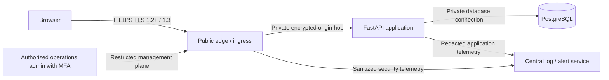

# MaaleNex A5.3.5 — F-04 Production-Edge Security Design and Acceptance Contract

**Status:** OWNER-REQUESTED DESIGN AND ACCEPTANCE PACKAGE PREPARED; operational edge acceptance remains pending  
**Scope:** F-04 — HSTS/CSP ownership, TLS termination, ingress security and evidence-based production-edge acceptance  
**Parent baseline:** A5.3.3 TLS/proxy/cookie/CORS/ingress contract; A5.3.4 application controls  
**Change class:** Documentation-only; no runtime, application, infrastructure or provider changes

## 1. Decision and disposition

F-04 is resolved at the **design and acceptance-contract level** by this document. It is not claimed as operationally or production-verified. There is no approved/selected hosting provider, public hostname inventory, production TLS endpoint, deployed ingress, or external scan evidence in the repository. Those facts make a live-edge PASS impossible today.

The normative decisions below remove ambiguity about policy ownership and define the exact evidence required before F-04 can be marked operationally VERIFIED-CLOSED:

1. The **public ingress/edge is the single authoritative owner** of HSTS and Content-Security-Policy (CSP) for production browser responses.
2. The application remains responsible for application authorization, CSRF, CORS, secure-cookie behavior, and the existing baseline response headers. It MUST NOT be used as a fallback for HSTS or CSP policy that the edge is expected to enforce.
3. The edge MUST remove any upstream HSTS/CSP values before adding exactly one canonical policy of each type. Duplicate or conflicting values are a failed acceptance result.
4. TLS terminates at the approved public edge. The edge-to-application hop MUST remain private and encrypted (TLS with certificate/hostname validation; mutually authenticated TLS is preferred where supported). The application origin MUST NOT be publicly reachable around the edge.
5. The approved G1 topology is a single trusted final proxy hop, consistent with A5.3.4's immediate-peer trust and single-hop client-IP contract. No trust-all forwarded-header configuration or unreviewed multi-hop chain is permitted.
6. Production activation remains blocked until all acceptance gates in §10 pass and a separate Owner approval authorizes the relevant operational change.

**Disposition:** F-04 = **DESIGN-RESOLVED / OPERATIONAL ACCEPTANCE PENDING**. Overall A5 remains **NOT READY / NO-GO**. This package does not authorize deployment, DNS, certificate issuance, hosting purchase, firewall changes, production secrets, or runtime configuration changes.

## 2. Scope and non-goals

### In scope
- Ownership and precedence for HSTS and CSP.
- Public TLS termination and edge-to-origin trust.
- Public ingress and origin exposure controls.
- CSP policy construction, report-only rollout, enforcement and rollback.
- HSTS staged activation and rollback constraints.
- Configuration, browser, external-scan and operational evidence required for acceptance.

### Explicitly out of scope
- Selecting or purchasing a provider.
- Registering or changing DNS or domain names.
- Issuing, installing or rotating certificates/private keys.
- Provisioning a load balancer, CDN, WAF, firewall, VPC or ingress controller.
- Changing application source, middleware, runtime settings, environment variables or production secrets.
- Enabling production APP_ENV, disabling SYNTHETIC_DATA_ONLY, changing the local maalenex_dev database restriction, or otherwise bypassing current runtime hard stops.
- Real-user data, payments, SMS/email delivery, GPS, commercial operation, merge or deployment.

## 3. Normative ownership and header policy

| Control | Sole production owner | Application responsibility | Acceptance rule |
|---|---|---|---|
| TLS public listener | Public edge | No public TLS termination assumptions | TLS 1.2 minimum; TLS 1.3 preferred; valid chain/SAN |
| HTTP-to-HTTPS redirect | Public edge | No trust of unvalidated forwarding headers | All HTTP application paths redirect to the exact canonical HTTPS origin |
| HSTS | Public edge | App MUST NOT add HSTS | Exactly one edge-generated Strict-Transport-Security header on HTTPS responses |
| CSP / CSP-Report-Only | Public edge | App supplies a reviewed asset/integration inventory; no duplicate CSP header | Exactly one effective policy header; report-only before enforcement |
| X-Content-Type-Options | Existing application baseline; edge may preserve | Continue `nosniff` | Exactly one effective value: `nosniff` |
| Referrer-Policy | Existing application baseline; edge may preserve | Continue `strict-origin-when-cross-origin` or stricter reviewed value | No downgrade |
| X-Frame-Options | Existing application baseline | Continue `DENY` for current no-embedding product | Must agree with CSP `frame-ancestors 'none'` |
| Permissions-Policy | Existing application baseline | Keep restrictive feature allowlist | No unreviewed feature enablement |
| CORS | Application | Exact normalized allowlist and credential rules remain authoritative | Edge MUST NOT broaden, reflect or wildcard CORS |
| Cookie/CSRF | Application | Secure, HttpOnly, SameSite=Lax; strict Origin and session-bound CSRF | Edge TLS and proxy metadata must preserve the verified scheme contract |

The edge configuration MUST strip upstream `Strict-Transport-Security`, `Content-Security-Policy` and `Content-Security-Policy-Report-Only` before applying its centrally managed policy. The edge MUST NOT create two CSP policies by independently appending a second value; multiple CSP policies can combine restrictively and break functionality in ways that obscure policy ownership.

The existing application security headers remain enabled. The edge MUST preserve them or apply an explicitly reviewed equivalent; it must not weaken or silently remove them. The current app's `X-Frame-Options: DENY` and planned CSP `frame-ancestors 'none'` are intentionally aligned.

## 4. Production-edge logical topology



Requirements:
- Public traffic reaches only the edge. The application listener and database are private and deny direct public ingress.
- The edge accepts only approved hostnames and rejects unknown Host/SNI values; it does not route arbitrary Host headers to the application.
- The edge overwrites, rather than appends to or trusts, client-supplied forwarding headers. It sends exactly one canonical `X-Forwarded-For` client address and exactly one `X-Forwarded-Proto: https` to the application.
- The app's trusted-proxy CIDR list contains only the actual edge-origin source addresses. The origin firewall/security group admits the app port only from those sources.
- The app is launched with Uvicorn proxy-header auto-trust disabled (as documented in A5.3.4); application trust is established by the reviewed middleware and exact peer allowlist.
- The edge-to-origin connection uses authenticated TLS and validates the origin certificate/hostname. No plaintext public or cross-network origin hop.
- Management interfaces are not internet-public; access requires MFA, least privilege, an audit trail and a restricted management path.
- Database access is private and limited to the application identity and approved administrative recovery path.
- Edge egress is deny-by-default except for documented dependencies such as certificate validation/renewal, logging, monitoring and explicitly approved integrations.

## 5. TLS and certificate profile

| Area | Required production profile | Evidence |
|---|---|---|
| Protocol | TLS 1.2 minimum; TLS 1.3 preferred; SSL, TLS 1.0 and TLS 1.1 disabled | Independent external protocol scan |
| Cipher policy | Provider-supported modern AEAD suites; no NULL, anonymous, export, RC4, 3DES or weak legacy suites | External cipher scan and reviewed provider configuration |
| Host identity | Exact public hostname in SAN; trusted chain; valid dates; correct SNI | Automated chain/SAN validation from independent network |
| Redirect | HTTP redirects to one canonical HTTPS host/path without open redirect or host reflection | HTTP probe for every hostname and representative paths |
| Origin hop | Encrypted and certificate/hostname validated; private reachability | Config review and network reachability test |
| Renewal | Automated renewal, expiry alerts and tested renewal-failure procedure | Renewal rehearsal, alert delivery and runbook evidence |
| Revocation/compromise | Provider/key revocation and replacement procedure; no private key in Git, app logs or frontend | Controlled tabletop/exercise and access audit |

Certificate selection, issuance and domain ownership are not established by this design. No certificate should be created or installed until the Owner approves a provider, exact domain inventory, data-location assessment and operator access model.

## 6. HSTS policy and staged acceptance

HSTS is emitted only by the edge and only over HTTPS. It is not emitted on HTTP responses. The rollout is deliberately staged to avoid pinning browsers to hostnames or subdomains that are not yet HTTPS-ready.

| Stage | Policy | Preconditions | Exit evidence |
|---|---|---|---|
| H0 — disabled | No HSTS | Current state; no live public endpoint verified | Confirmed absence of accidental HSTS at all known endpoints |
| H1 — canary | `max-age=300` | Exact hostname verified HTTPS-only; valid certificate and redirect; no mixed content | Browser and external probes pass; no subdomain directive |
| H2 — observation | `max-age=86400` | At least 7 days of stable H1 telemetry and all routes tested | No HTTP dependencies, TLS errors or redirect loops; Owner approval recorded |
| H3 — steady state | `max-age=31536000` | All services on that hostname are permanently HTTPS; renewal and recovery tested | Full inventory and external scan; one year max-age verified |
| H4 — optional domain-wide | Add `includeSubDomains` only by separate approval | Every current and planned subdomain inventoried, HTTPS-capable, owned and recoverable | Explicit Owner decision plus domain-wide test |
| Preload | Not enabled by this contract | Requires separate legal/technical and Owner review | Separate approval; never inferred from H3/H4 |

Do not enable `includeSubDomains` or preload as a default. HSTS is sticky in browsers; rollback cannot immediately clear a previously cached long max-age. The recovery plan must account for that browser behavior. HSTS rollout MUST pause if any hostname, redirect, certificate or mixed-content check fails.

## 7. CSP construction and rollout

### 7.1 Policy construction requirements

CSP MUST be built from the production-built frontend artifact and a signed-off inventory of actual API, font, image, analytics and identity integrations. Do not guess origins from development configuration.

The starting policy shape for compatibility review is:

```http
Content-Security-Policy-Report-Only: default-src 'self'; base-uri 'self'; object-src 'none'; frame-ancestors 'none'; form-action 'self'; script-src 'self' 'nonce-{PER_RESPONSE_NONCE}'; style-src 'self' 'nonce-{PER_RESPONSE_NONCE}'; img-src 'self' data:; font-src 'self'; connect-src 'self' {APPROVED_API_ORIGINS}; upgrade-insecure-requests
```

This is a **template**, not a deployable literal. The nonce MUST be cryptographically unpredictable, unique per response and consistently applied to every permitted inline script/style. Prefer build-time hashes for static inline assets when appropriate. Do not insert a fixed nonce or expose a nonce through logs. Remove nonce sources if no inline content requires them.

CSP design rules:
- `default-src 'self'` baseline.
- `object-src 'none'`, `base-uri 'self'`, `frame-ancestors 'none'`, and `form-action 'self'`.
- `script-src` MUST NOT include `'unsafe-eval'`; avoid `'unsafe-inline'`. Any exception requires a documented threat rationale, a narrow scope and expiry.
- `style-src` should use same-origin assets plus nonce/hash where required; do not allow broad third-party style origins.
- `connect-src` contains only the approved API and explicitly approved telemetry/report endpoints. It MUST NOT use `*`.
- `img-src`, `font-src`, `media-src`, `worker-src` and `manifest-src` are limited to actual application requirements.
- Third-party analytics, maps, payment widgets, identity providers and external fonts are not presumed approved. Each requires a data-flow, privacy, integrity and vendor review.
- `frame-ancestors 'none'` is mandatory while the product has no approved embedding use case.
- `upgrade-insecure-requests` is enabled only after all application assets and integrations are HTTPS-ready.
- `report-to` / `report-uri` destination is same-origin or explicitly approved; reports are rate-limited, size-bounded, sanitized and treated as untrusted input. Never include cookies, authorization headers or user-entered content in CSP reports.

### 7.2 Rollout sequence

1. Inventory production build assets, inline script/style requirements, API endpoints, fonts, images, workers, and integrations. Assign an owner to each origin.
2. Generate a restrictive candidate policy; review it against the built artifact and route inventory.
3. Deploy as `Content-Security-Policy-Report-Only` at the edge in a non-production-equivalent staging environment. Keep enforcement disabled.
4. Exercise login, logout, account recovery, registration, guest challenge/booking, search, reservation, support, Amharic UI, offline PWA shell and all approved service-worker behavior using synthetic accounts/data.
5. Triage every report. Distinguish genuine required resources from injected content, browser extensions and malformed traffic. Do not blindly allow reported origins.
6. Require zero unexplained first-party violations over an agreed observation window (minimum seven days of representative staging use) and documented disposition for every remaining report class.
7. Enforce CSP in staging; run full browser regression and accessibility smoke checks. Verify no inline/eval exception has been added merely to make the tests pass.
8. Production CSP enforcement requires a separate change approval and rollback rehearsal. Keep a known-good report-only policy and previous edge configuration available.
9. Review reports and violations after activation; rollback only the CSP policy to the last known-good policy, never disable TLS, Origin/CSRF, CORS or runtime safety controls.

### 7.3 CSP rollback

Rollback means restore the last reviewed CSP header or temporarily return to the approved report-only policy. It does not mean remove all response security headers, allow all sources, add wildcard origins, enable unsafe-eval, or weaken authentication. A rollback must be time-bounded, logged, approved and followed by a defect record.

## 8. Edge ingress hardening requirements

| Control | Required behavior |
|---|---|
| Host/SNI | Exact approved host allowlist; unknown host denied; no Host-header reflection |
| Listener | Public 80 only for canonical redirect; public 443 for application; no other public listener |
| Origin | Private listener; source allowlist restricted to edge; no direct-origin bypass |
| Forwarding | Strip all inbound forwarding headers; set canonical one-hop XFF and HTTPS proto |
| Methods | Allow only required methods; reject TRACE and unused methods at edge and app |
| Request limits | Bounded body, header, URL and upload sizes; align with application limits |
| Timeouts | Bounded connect/read/write/keepalive; defend slow-client exhaustion |
| Rate limits | Edge + application rate controls; separate authentication, recovery, challenge, search and booking classes |
| DDoS/WAF | Provider-neutral baseline protection; explicit false-positive and emergency bypass controls; bypass requires Owner approval |
| Caching | Never shared-cache authenticated, CSRF, booking or personal responses; correct Vary behavior for CORS; public cache only for explicitly public immutable assets |
| Errors | Generic external errors; no stack traces, internal hostnames, tenant metadata or secret details |
| Logging | Redact cookies, authorization, CSRF, session/challenge tokens, personal identifiers and request bodies; restricted access and retention |
| Observability | TLS expiry, renewal, 4xx/5xx, rate-limit, proxy trust, Origin/CORS denials, CSP reports and config drift alerts |
| Admin | MFA, least privilege, separate management plane, immutable/auditable change history |
| Network | App and DB private; deny-by-default ingress and egress; documented DNS and network dependencies |

## 9. Evidence package and responsibilities

Every gate requires evidence captured from the actual approved staging/production-equivalent edge, not inferred from source code or CI.

| Evidence ID | Required artifact | Accountable role |
|---|---|---|
| EDGE-E01 | Approved hostname and subdomain inventory, DNS ownership and service mapping | Owner / domain operator |
| EDGE-E02 | Reviewed edge topology, trust boundary and origin reachability diagram | Platform architect |
| EDGE-E03 | Sanitized edge configuration export and configuration checksum/version | Edge operator |
| EDGE-E04 | Certificate chain/SAN/expiry checks and renewal rehearsal | TLS operator |
| EDGE-E05 | Independent TLS protocol/cipher/hostname scan | Security verifier |
| EDGE-E06 | HTTP redirect, Host/SNI rejection and direct-origin bypass tests | Security verifier |
| EDGE-E07 | Exactly-one HSTS and CSP header tests on all public response classes | Edge operator + verifier |
| EDGE-E08 | CSP report-only observation, violation triage and enforced browser regression | Frontend owner + security verifier |
| EDGE-E09 | Forwarded-header spoofing, duplicate, malformed and client-IP isolation tests at real edge | Platform/security owner |
| EDGE-E10 | WAF/rate-limit/request-limit/cache/log-redaction tests | Edge operator |
| EDGE-E11 | Alert delivery, certificate expiry and config-drift exercise | Operations owner |
| EDGE-E12 | Rollback rehearsal and recovery evidence | Operations owner |
| EDGE-E13 | Approved data location, vendor access, privacy and retention review | Owner + qualified counsel/advisers |
| EDGE-E14 | Final signed acceptance record, exact config version and Owner go/no-go | Owner |

No provider-specific config is accepted without review against this contract. Evidence must include timestamp, hostname, source vantage, tool/version, exact policy/config revision, outcome, exceptions and verifier. Sensitive config and scan output must be stored in access-controlled records; redact secrets and internal IPs before broad sharing.

## 10. Acceptance matrix and go/no-go gates

| Gate | Acceptance test | PASS condition | Current status |
|---|---|---|---|
| F04-01 Ownership | Inspect edge and app response headers | Edge is sole HSTS/CSP owner; app does not emit duplicate policy | DESIGN PASS; live pending |
| F04-02 TLS | External scan of every hostname | TLS 1.2/1.3 only; valid chain/SAN; no weak cipher/protocol | NOT RUN — no endpoint |
| F04-03 Redirect | HTTP probe of every hostname and path class | Exact canonical HTTPS redirect; no loop/open redirect | NOT RUN — no endpoint |
| F04-04 HSTS | Inspect HTTP and HTTPS responses across all public routes | No HSTS on HTTP; exactly one staged HSTS on HTTPS; no unapproved subdomain/preload directive | NOT RUN — no endpoint |
| F04-05 CSP report-only | Browser exercise with representative synthetic workflows | One edge policy; no unexplained first-party violations after ≥7 days representative staging | NOT RUN — no staging edge |
| F04-06 CSP enforcement | Browser regression after report-only approval | Enforced policy preserves all approved workflows; no unsafe-eval/unsafe-inline exception | NOT RUN — no staging edge |
| F04-07 Origin bypass | Attempt direct access to origin from public network | App origin unreachable except through approved edge | NOT RUN — no infrastructure |
| F04-08 Proxy trust | Spoof XFF/proto/host from trusted and untrusted peers | Only immediate allowlisted edge is trusted; canonical one-hop values; malformed/duplicate rejected | Application CI PASS; live edge pending |
| F04-09 Ingress controls | Exercise methods, limits, timeouts, rate limits, cache and WAF | All documented limits enforced; no sensitive response shared-cache | NOT RUN — no edge |
| F04-10 Logging/alerts | Send synthetic security events and test alert routing | No secrets/PII in logs; alerts reach named on-call owner | NOT RUN — no operations |
| F04-11 Recovery | Rehearse certificate, CSP and edge-config rollback | Recovery meets approved RTO; auth/CSRF/runtime restrictions remain intact | NOT RUN — no edge |
| F04-12 Governance | Review all evidence and approvals | Named operators, Owner approval and explicit deployment authorization recorded | PENDING |

### Go/no-go rule

- Any FAIL, UNKNOWN or NOT RUN item in F04-02 through F04-12 is a **NO-GO for production edge activation**.
- F04-01 design is resolved by this contract; its live ownership verification remains required.
- No test may be waived by changing the application to trust arbitrary proxies, accepting missing Origin, broadening CORS, disabling CSRF, permitting public origin access, or weakening current environment/data restrictions.
- An exception requires a documented risk, compensating control, expiry, accountable owner and explicit Owner approval; critical TLS, Origin/CSRF, origin-isolation and runtime hard-stop requirements are not waivable in this stage.

## 11. Configuration and runtime safety invariants

The following controls remain immutable throughout this design stage and all acceptance preparation:

- `APP_ENV` remains restricted to development/test.
- `SYNTHETIC_DATA_ONLY=true` remains mandatory.
- Database remains local `maalenex_dev`; no production DB host or credentials are introduced.
- No production secret/key generation, import, rotation or retrieval.
- No DNS, certificate, hosting, ingress, firewall, WAF, CDN, network or runtime configuration changes.
- Existing exact CORS allowlists, trusted-proxy peer checks, strict Origin enforcement, session-bound CSRF and cookie protections remain enabled.
- Uvicorn's automatic proxy-header trust remains disabled; only the application middleware's explicit peer allowlist is authoritative.
- No real user data, payments, SMS/email, GPS, production operations, merge or deployment.

Any proposed change that weakens one of these invariants is outside this authorization and MUST be rejected.

## 12. Readiness, blockers and next stage

### Resolved by this package
- Single authoritative HSTS/CSP owner selected: public edge.
- Application-vs-edge header responsibilities defined.
- TLS termination and private origin-hop architecture specified.
- HSTS staged rollout, subdomain/preload guardrails and rollback defined.
- CSP construction, report-only observation, enforcement and safe rollback defined.
- Provider-neutral ingress controls and exact acceptance evidence defined.
- Explicit no-go criteria and runtime safety invariants recorded.

### Still blocked on real-world inputs
- Approved domain/hostname/subdomain inventory and domain ownership.
- Provider/region/data-residency and vendor/security review.
- Named edge operator, security verifier and on-call owner.
- Approved infrastructure design and separately authorized provisioning.
- Actual edge config, TLS certificates, external scan, CSP report-only observation and browser acceptance.
- Operational rollback and incident-response exercises.

### Stage transition

This document closes **F-04 design ambiguity**, not operational F-04. The next permissible stage is A5.3.6 provider-neutral deployment specification and acceptance-test harness preparation using synthetic fixtures only. Provider selection, infrastructure provisioning, DNS/certificate changes, runtime production configuration, deployment and activation each require their own explicit approval.

## 13. Change record

- Documentation-only addition to `a5/a5-3-4-edge-security-hardening`.
- No application code, test code, database schema, migration, workflow or runtime config changed.
- No provider selected; no infrastructure or public endpoint created.
- No secrets, keys, certificates or DNS records changed.
- No external network scan, email, payment, GPS, real-data processing, merge or deployment occurred.
- Existing A5.3.4 application fixes F-01/F-02/F-03 remain intact and are not weakened.

## 14. Related artifacts

- [A5.3.3 TLS/proxy/cookie/CORS/ingress security contract](MAALENEX-A5-3-3-TLS-PROXY-COOKIE-CORS-INGRESS-SECURITY-CONTRACT.md)
- [A5.3.4 edge security implementation report](MAALENEX-A5-3-4-EDGE-SECURITY-IMPLEMENTATION-REPORT.md)
- [A5.3.4 focused security review](MAALENEX-A5-3-4-FOCUSED-SECURITY-REVIEW.md)
- [A5.3 infrastructure, secrets and TLS assessment](MAALENEX-A5-3-INFRASTRUCTURE-SECRETS-TLS-ASSESSMENT.md)
- [Overall A5 deployment-readiness assessment](MAALENEX-A5-DEPLOYMENT-READINESS-ASSESSMENT.md)
