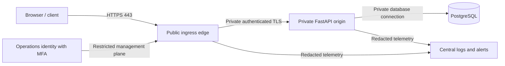

# MaaleNex A5.3.6 — Provider-Neutral Deployment Specification and Synthetic Edge Acceptance Harness

**Status:** SPECIFICATION PREPARED; SYNTHETIC HARNESS VERIFIED — no live-edge acceptance  
**Parent:** A5.3.5 F-04 production-edge design and acceptance contract  
**Parent commit:** `38be5af657f26335209bf908e3765a6b2e27c67a`  
**Work branch:** `a5/a5-3-6-provider-neutral-deployment-spec`  
**Change class:** Provider-neutral documentation plus offline synthetic evidence validator  
**Production decision:** **NOT READY / NO-GO**

## 1. Purpose and governing decisions

This package translates the Owner-approved A5.3.5 design into a provider-neutral deployment specification and a repeatable, offline acceptance-evidence harness. It is intended to make later provider-specific work reviewable without selecting a vendor or creating infrastructure now.

A5.3.5 remains authoritative for F-04 policy decisions:
- The public ingress edge is the sole production owner of HSTS and CSP.
- The application remains authoritative for CORS, Origin/CSRF, cookie behavior and its existing baseline security headers.
- The edge strips upstream HSTS/CSP values and emits one canonical policy of each type.
- The public origin is private and reachable only from the approved edge over an authenticated encrypted hop.
- Exactly one trusted final proxy hop supplies canonical HTTPS scheme and client address metadata.
- Production activation requires all applicable F04-01–F04-12 gates and a separate written Owner authorization.

This document does not supersede A5.3.5 or convert a design decision into operational evidence.

## 2. Explicit scope and exclusions

### Included
1. Logical deployment topology and component responsibilities.
2. Environment-separation and network trust model.
3. Provider-neutral configuration requirements and deployment sequence.
4. Secret/key injection and access-control requirements, without secret values.
5. TLS, HSTS, CSP, proxy, CORS, cookie, ingress, logging and recovery acceptance criteria.
6. A standard-library Python harness that validates a synthetic evidence fixture offline.
7. A no-secret, no-network GitHub Actions workflow to execute the harness and its regression tests.

### Not included or authorized
- Provider selection, account creation, purchase, paid services, billing or provisioning.
- DNS/domain registration or modification; certificate issuance, installation or renewal.
- Firewall, VPC, CDN, WAF, load balancer, ingress, network or hosting changes.
- Production secrets, encryption keys, credentials, runtime configuration or production database.
- Enabling production APP_ENV, disabling synthetic-only mode, changing the local database restriction or weakening any security control.
- Live endpoint probing, external TLS scans, browser sessions against a deployed edge, SMTP/email, SMS, payments, GPS, real user data, commercial operation, merge, deployment or activation.

The harness does not make network requests and cannot establish that an actual edge is secure.

## 3. Logical target topology



### Component boundaries

| Component | Required responsibility | Prohibited behavior |
|---|---|---|
| Public edge | Host/SNI allowlist, public TLS, HTTP redirect, sole HSTS/CSP policy, request limits, rate controls, cache policy, sanitized one-hop forwarding, edge telemetry | Publicly expose the origin; trust client-supplied forwarding chains; append duplicate HSTS/CSP; cache authenticated or personal responses |
| Application origin | Existing authentication/authorization, exact CORS, strict Origin, session-bound CSRF, secure cookies, service permissions, audit redaction and business validation | Trust arbitrary proxy headers; emit competing HSTS/CSP; accept missing Origin on browser cookie mutations |
| PostgreSQL | Private persistence, least-privilege application identity, controlled backup/recovery | Public listener or shared environment database |
| Management plane | MFA, least privilege, named operators, auditable change and recovery | Public unauthenticated administration or shared human credentials |
| Telemetry | Redacted security events, bounded retention, alert delivery and access audit | Store credentials, cookies, CSRF/session/challenge tokens, raw personal identifiers or request bodies |

### Proxy contract

The edge must remove client-provided forwarding headers and overwrite them with exactly one canonical `X-Forwarded-For` client address and one `X-Forwarded-Proto: https`. It must connect from an explicitly allowlisted source range. The app retains the immediate peer identity and rejects missing, duplicate, comma-separated, malformed or downgraded metadata. Uvicorn proxy-header auto-trust remains disabled. No multi-hop chain is inferred or permitted by this specification.

## 4. Environment separation and current runtime boundary

| Environment | Intended purpose | Data | Network and credentials | Current status |
|---|---|---|---|---|
| Local development | Developer iteration | Synthetic only | Loopback services; developer-local values | Existing supported mode |
| CI test | Automated regression and migrations | Synthetic fixtures only | Ephemeral PostgreSQL service; ephemeral test values; no production secrets | Existing supported mode |
| Staging (future design only) | Production-equivalent acceptance before any release | Synthetic accounts and data only | Separate account/network/database and isolated credentials; edge not provisioned by this package | NOT PROVISIONED / NOT AUTHORIZED |
| Production (future design only) | Real service after separate release decision | Only legally approved, minimized data | Separate provider account, private origin/database, managed secrets and named operators | BLOCKED / NOT IMPLEMENTED |

The current application hard stops remain mandatory in every run of this package:
- `APP_ENV` is only `development` or `test`.
- `SYNTHETIC_DATA_ONLY=true`.
- PostgreSQL remains loopback-only and database `maalenex_dev`.
- No production mode or remote database is introduced.
- No production key, credential, hostname or provider-specific configuration is stored in this repository.

A future staging or production architecture is a design target only. It must not be simulated by changing the current runtime guard.

## 5. Provider-neutral deployment specification

A later provider-specific design must supply equivalent controls for every item below. Product names and vendor-specific feature labels are intentionally omitted.

### 5.1 Public edge and origin
- One approved public ingress boundary; only required public listeners (HTTP redirect and HTTPS application).
- Exact Host and SNI allowlist; unknown hosts rejected without reflection.
- HTTP redirects to one canonical HTTPS origin with no open redirect, scheme downgrade or host-header influence.
- Public origin listener is not directly reachable; network policy permits only the edge's exact source addresses.
- Edge-to-origin transport is encrypted and validates the origin certificate and hostname; mutual TLS is preferred where supported.
- Application origin and database are on private network segments; ingress and egress default-deny except documented dependencies.
- Administrative control plane is private/restricted, MFA-protected and auditable.

### 5.2 TLS and certificate operations
- TLS 1.2 minimum; TLS 1.3 preferred; obsolete protocols and weak/anonymous ciphers disabled.
- Certificate SAN, chain, hostname, validity and SNI are verified independently for every approved hostname.
- Renewal automation, expiry alerting, renewal-failure handling and revocation/replacement procedure are documented and rehearsed.
- HSTS is emitted only by the edge on HTTPS responses. Rollout follows A5.3.5 H0–H3; `includeSubDomains` and preload require separate Owner approval.
- No certificate or private key may be committed, placed in a frontend artifact, logged or attached to a public CI run.

### 5.3 HSTS and CSP ownership
- Edge strips upstream HSTS, CSP and CSP-Report-Only headers, then emits exactly one canonical policy.
- App does not add HSTS/CSP as a competing policy owner.
- CSP is built from the actual production-built artifact and approved integration inventory; no guessed third-party origins.
- Report-only observation lasts at least seven representative days in a future authorized staging environment. Unexplained first-party violations must be zero before enforcement.
- No `unsafe-eval`, broad wildcard source, or `unsafe-inline` exception merely to make a workflow pass.
- CSP rollback restores the last reviewed policy or approved report-only policy; it never disables TLS, CORS, Origin/CSRF, authentication or runtime guards.

### 5.4 CORS, cookies and browser mutation security
- Application owns exact normalized credentialed CORS allowlists; no wildcard, reflection, suffix match or null origin.
- Cookie-authenticated browser mutations require exactly one allowed Origin and the existing session-bound CSRF check.
- Session cookies remain Secure, HttpOnly, host-only and SameSite=Lax. CSRF cookie remains intentionally script-readable and is paired with the server-verified token/digest.
- Edge must preserve the external HTTPS scheme contract; app trusts only the configured immediate peer.
- CORS is not treated as a substitute for CSRF.

### 5.5 Ingress, caching and abuse controls
- Explicit allowlist of required methods; TRACE and unused methods rejected.
- Bounded request/header/URL/upload sizes, connection/read/write/keepalive timeouts and slow-client protection.
- Edge and application rate controls are separately defined for authentication, recovery, challenge, search and booking traffic.
- WAF/DDoS controls have documented false-positive handling; emergency bypass requires separate Owner approval and must not bypass authentication or origin isolation.
- Authenticated, booking, CSRF and personal responses are never shared-cacheable. Public caching is limited to explicitly public immutable assets with correct Vary behavior.
- External errors are generic and reveal no stack traces, internal hostnames, tenant metadata or secret details.

### 5.6 Secrets, keys and access
- Future provider secret storage must support least-privilege IAM, MFA, access audit, rotation, revocation and recovery.
- Development, CI, staging and production credentials are unique and isolated. Untrusted pull-request jobs receive no privileged secrets.
- Key generation/rotation follows the separate A5.3.2 lifecycle design; no direct environment-variable replacement for encryption or lookup keys.
- CI logs, artifacts, manifests and test reports contain references/versions only, never secret values.
- Named owners are assigned for provider account, domain, TLS, edge operations, security verification, incident response and recovery.

### 5.7 Logging, monitoring and recovery
- Redact authorization, cookies, CSRF, session/challenge tokens, personal identifiers and request bodies before persistence.
- Monitor certificate expiry/renewal, 4xx/5xx, rate-limit events, proxy/Origin/CORS denials, CSP violations, configuration drift and origin reachability.
- Test alert routing to a named on-call owner; synthetic CI success is not alert-delivery evidence.
- Maintain versioned edge configuration, reviewed rollback package, backup/restore and incident runbooks.
- Record recovery objective and actual rehearsal results; preserve authentication, CSRF and runtime restrictions throughout recovery.

## 6. Deployment and acceptance sequence (future, gated)

| Step | Required work | Exit evidence | Current disposition |
|---|---|---|---|
| D0 | Owner-approved provider, region, domain inventory, account owner and data-residency review | Signed decision and vendor/security record | NOT STARTED |
| D1 | Provider-neutral design mapped to selected provider capabilities | Reviewed architecture, threat model and config mapping | SPECIFIED; no provider mapping |
| D2 | Separate staging account/network/database and synthetic-only access | Account/network inventory and guard tests | NOT PROVISIONED |
| D3 | Edge and private origin implementation | Sanitized config export, revision and reachability evidence | NOT IMPLEMENTED |
| D4 | TLS, redirect, HSTS staged rollout and CSP report-only | External scan, header probes and seven-day report-only evidence | NOT RUN |
| D5 | Proxy, Origin/CSRF, CORS, cache, rate, WAF and origin-isolation tests | Real-edge synthetic browser/network test evidence | NOT RUN |
| D6 | Logging, alert delivery, backup and rollback rehearsal | Redacted event samples, alert receipt and recovery timings | NOT RUN |
| D7 | F04-01–F04-12 evidence review and signed go/no-go | Complete evidence register and separate Owner approval | BLOCKED |
| D8 | Any deployment or activation | Separate explicit authorization and deployment record | NOT AUTHORIZED |

No step above is authorized for execution against live infrastructure by this A5.3.6 package.

## 7. Synthetic acceptance harness

### 7.1 What it does

The offline harness is `backend/scripts/a5_3_6_edge_acceptance.py`. It validates a JSON fixture against the A5.3.5 F-04 control assertions and checks that the fixture itself is safely synthetic. It uses only the Python standard library and makes no network calls.

The harness:
- requires a reserved `.invalid` hostname and a synthetic fixture evidence mode;
- requires test/development mode, synthetic-only data, local database host and `maalenex_dev`;
- rejects endpoint contact, production data, embedded secret values or an asserted Owner/deployment approval;
- validates the fixture assertions for F04-01 through F04-11;
- always reports F04-12 as `NOT_EVALUATED`, because governance approval cannot be manufactured by a synthetic fixture;
- reports overall production acceptance as `NOT_EVALUATED_NO_LIVE_EDGE_EVIDENCE`, even when every synthetic assertion passes.

### 7.2 What it cannot prove

A `SYNTHETIC_PASS_NOT_LIVE` is only a fixture-schema/logic pass. It is not proof of a deployed TLS endpoint, actual header behavior, actual WAF/rate limits, private origin isolation, CSP observation, alert delivery, operator identity, provider controls, legal compliance or rollback. The harness deliberately has no endpoint URL option, HTTP client, DNS resolver, cloud SDK, credential input or production mode.

### 7.3 Run locally (synthetic fixture only)

From the repository root:

```bash
python backend/scripts/a5_3_6_edge_acceptance.py --manifest backend/tests/fixtures/a5_3_6_edge_acceptance.synthetic.json
python -m unittest discover -s backend/tests -p 'test_a5_3_6_edge_acceptance.py' -v
```

The fixture is intentionally illustrative and uses only reserved `.invalid` names and fake identifiers. Do not replace it with live endpoint output or secret-bearing configuration.

### 7.4 Gate-to-harness mapping

| F-04 gate | Offline assertion coverage | Live acceptance still required |
|---|---|---|
| F04-01 | Edge ownership and no app/duplicate policy headers | Actual edge/app response inspection |
| F04-02 | TLS profile assertion fields | Independent scan of every hostname |
| F04-03 | Canonical redirect assertion fields | Real HTTP/HTTPS redirect and host-reflection probes |
| F04-04 | HTTP/HSTS count and staged policy fields | Actual HTTP/HTTPS response headers |
| F04-05 | Report-only mode, ≥7 days, zero unexplained violations | Representative staging browser telemetry |
| F04-06 | Enforced CSP and browser-regression assertions | Actual browser workflow matrix |
| F04-07 | Origin-isolation assertion fields | Public network direct-origin reachability test |
| F04-08 | Single-hop, overwrite and fail-closed proxy assertions | Spoofing tests through actual edge and origin |
| F04-09 | Method/limit/cache/rate-control assertions | Actual ingress and cache behavior |
| F04-10 | Redaction and alert-routing assertion fields | Sanitized logs and delivered alert receipt |
| F04-11 | Rollback and recovery assertion fields | Rehearsal with measured recovery and control preservation |
| F04-12 | Deliberately never passes in synthetic mode | Signed evidence and separate Owner go/no-go |

## 8. Evidence manifest contract

The sample fixture at `backend/tests/fixtures/a5_3_6_edge_acceptance.synthetic.json` is the canonical shape example. It contains:
- `meta`: schema version, evidence mode, environment, reserved hostname, source commit, synthetic config revision, capture timestamp, endpoint/data/secret flags and runtime-boundary assertions.
- `gates`: explicit typed assertions for F04-01 through F04-12.
- No credentials, key material, user data, real hostname, endpoint URL, internal IP or provider account identifier.

Evidence from an eventual real staging edge must not be passed to this synthetic harness. A future operational evidence verifier, if authorized, must be a separately reviewed tool with a separate threat model and strict secret/PII handling.

## 9. CI and verification policy

The A5.3.6 workflow is branch-scoped and performs only:
1. Python syntax compilation of the harness and tests.
2. Standard-library unittest regression tests.
3. Offline validation of the checked-in synthetic fixture.

It has no network step, service container, external endpoint, provider credential, SMTP secret, deployment permission or artifact containing secrets. CI results verify the harness implementation only. They do not upgrade any F-04 live gate to PASS.

## 10. F-04 readiness and acceptance disposition

| Gate | Design status | Synthetic harness | Operational status |
|---|---|---|---|
| F04-01 | DESIGN RESOLVED | Covered | NOT RUN |
| F04-02 | Specified | Assertion only | NOT RUN — no endpoint |
| F04-03 | Specified | Assertion only | NOT RUN — no endpoint |
| F04-04 | Specified | Assertion only | NOT RUN — no endpoint |
| F04-05 | Specified | Assertion only | NOT RUN — no staging edge |
| F04-06 | Specified | Assertion only | NOT RUN — no staging edge |
| F04-07 | Specified | Assertion only | NOT RUN — no infrastructure |
| F04-08 | App behavior verified in A5.3.4 CI | Assertion only | LIVE EDGE NOT RUN |
| F04-09 | Specified | Assertion only | NOT RUN — no edge |
| F04-10 | Specified | Assertion only | NOT RUN — no operations |
| F04-11 | Specified | Assertion only | NOT RUN — no edge |
| F04-12 | Owner decision required | Always NOT_EVALUATED | PENDING |

**A5.3.6 disposition:** Provider-neutral specification PREPARED; synthetic harness and regression suite **VERIFIED** on implementation HEAD `22c26c7f855117327a7d81b8ea74d2c4879f7cd2`; no-network CI run [#42574203977](https://github.com/akefadaka-git/maalenex-moto/actions/runs/42574203977) **PASS**. The companion [implementation and verification report](MAALENEX-A5-3-6-IMPLEMENTATION-AND-VERIFICATION-REPORT.md) records exact evidence. F-04 remains **DESIGN-RESOLVED / OPERATIONAL ACCEPTANCE PENDING**. Overall A5 remains **NOT READY / NO-GO**.

## 11. Immutable safety and governance invariants

- `APP_ENV` remains development/test only.
- `SYNTHETIC_DATA_ONLY=true` remains mandatory.
- Database remains loopback-only `maalenex_dev`.
- No production keys, credentials, secrets, provider, account, hostname or certificate are introduced.
- No DNS, hosting, ingress, firewall, WAF, CDN, network or runtime configuration changes.
- Existing exact CORS, trusted-proxy peer validation, strict Origin, session-bound CSRF and secure-cookie controls remain intact.
- Uvicorn proxy-header auto-trust remains disabled.
- No real personal data, payment, SMS/email, GPS, production operation, merge, deployment or activation.
- PR #11 and the default branch are not modified by this work; this package is kept on its own branch and draft PR.
- Any change that weakens these invariants is outside authorization and must be rejected.

## 12. Change record

A5.3.6 prepares a provider-neutral specification, an offline synthetic fixture validator, regression tests and a branch-scoped no-network CI workflow. Exact commit and CI evidence are recorded in the companion implementation report after verification.

No provider was selected, no infrastructure or endpoint was created, no external network request was made, no DNS/certificate/secret/runtime change occurred, and no merge, deployment or production activation was performed.

## 13. Verification report\n\nThe implementation and verification evidence is recorded in [MAALENEX-A5-3-6-IMPLEMENTATION-AND-VERIFICATION-REPORT.md](MAALENEX-A5-3-6-IMPLEMENTATION-AND-VERIFICATION-REPORT.md). The implementation regression run [#42574203977](https://github.com/akefadaka-git/maalenex-moto/actions/runs/42574203977) passed on `22c26c7f855117327a7d81b8ea74d2c4879f7cd2`. The documentation-inclusive HEAD `b6c06ada3d49dfa5313c603bba26c82408302368` also passed exact-head push run [#42574266512](https://github.com/akefadaka-git/maalenex-moto/actions/runs/42574266512) and PR run [#42574272458](https://github.com/akefadaka-git/maalenex-moto/actions/runs/42574272458), including compile, regression and fixture steps. This does not constitute operational edge acceptance.\n\n## 14. Related artifacts

- [A5.3.5 F-04 production-edge design and acceptance](MAALENEX-A5-3-5-F04-PRODUCTION-EDGE-DESIGN-AND-ACCEPTANCE.md)
- [A5.3.4 edge security implementation report](MAALENEX-A5-3-4-EDGE-SECURITY-IMPLEMENTATION-REPORT.md)
- [A5.3.4 focused security review](MAALENEX-A5-3-4-FOCUSED-SECURITY-REVIEW.md)
- [A5.3 infrastructure, secrets and TLS assessment](MAALENEX-A5-3-INFRASTRUCTURE-SECRETS-TLS-ASSESSMENT.md)
- [Overall A5 deployment-readiness assessment](MAALENEX-A5-DEPLOYMENT-READINESS-ASSESSMENT.md)
